# 🎬 คู่มือภาพจริงการใช้งาน Tora StoryVDO (Live Visual Guide)

> **บันทึกภาพจากระบบจริง (Captured from Live Running System)**  
> รวบรวมหน้าจอการทำงานจริงทุกขั้นตอน: ตั้งแต่เชื่อมต่อ Tora API, เขียนบทด้วย AI, สกัดตัวละคร, เลือก Model วิดีโอ จนถึงรวมคลิปด้วย FFmpeg

---

## 🖼️ โปสเตอร์สรุปขั้นตอนภาพรวม (Workflow Infographic)

ภาพรวมสรุป 6 ขั้นตอนหลัก จากการตั้งค่าสู่การได้คลิปละครสั้นเต็มเรื่อง:

  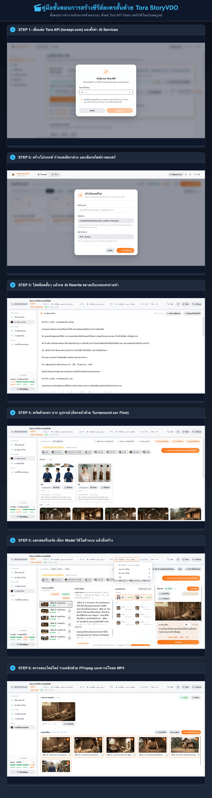

---

## 🔑 ขั้นตอนที่ 1: การเชื่อมต่อ Tora API Token และตั้งค่า AI Services

1. สมัครสมาชิกและสร้าง Token ที่เว็บไซต์ **[https://toraapi.com](https://toraapi.com)** จะได้รับรหัส API Key ในรูปแบบ `sk-...`
2. คลิกปุ่ม **"เชื่อมต่อ Tora"** ที่มุมขวาบนของแอปพลิเคชัน เพื่อเปิดหน้าต่างกรอก Token:

  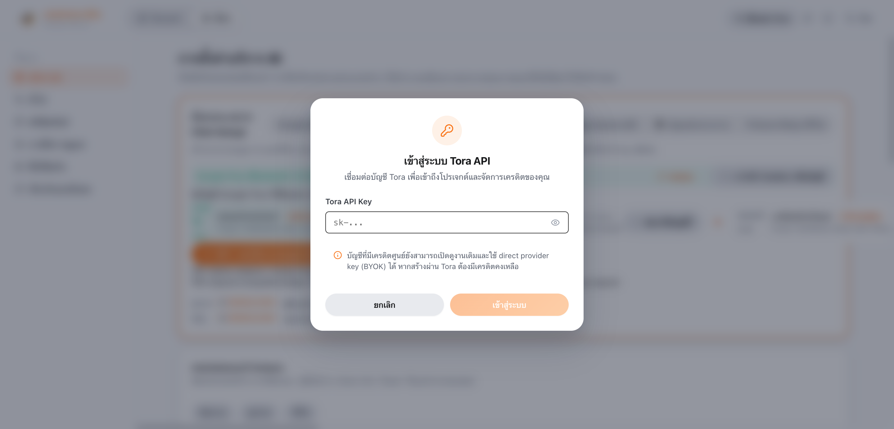

3. ตรวจสอบสถานะการตั้งค่าและเครดิตในหน้า **"ตั้งค่า" (Settings) ➜ "บริการ AI"**:

  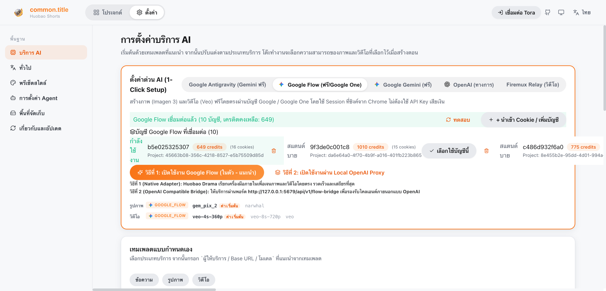

> [!NOTE]
> ในหน้าต่างตั้งค่านี้ คุณสามารถดูจำนวนบัญชี **Google Flow** ที่เชื่อมต่ออยู่ พร้อมจำนวนเครดิตคงเหลือ (เช่น 649 credits) และสามารถสลับบัญชีที่ต้องการใช้งานได้ทันที

---

## 🎬 ขั้นตอนที่ 2: การสร้างโปรเจกต์ใหม่และเลือกสไตล์ภาพ

1. ไปที่หน้าหลักของระบบ แล้วคลิกปุ่ม **"สร้างโปรเจกต์ใหม่"**

  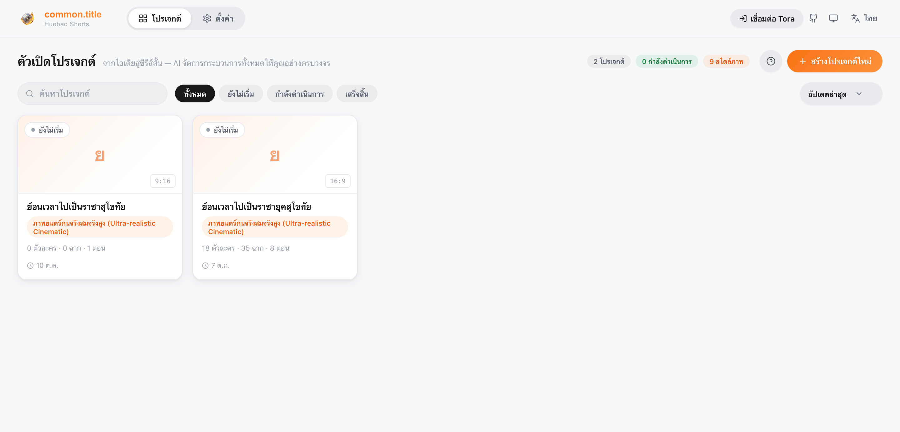

2. หน้าต่างสร้างโปรเจกต์จะปรากฏขึ้น ให้กำหนดข้อมูลหลักของซีรีส์:

  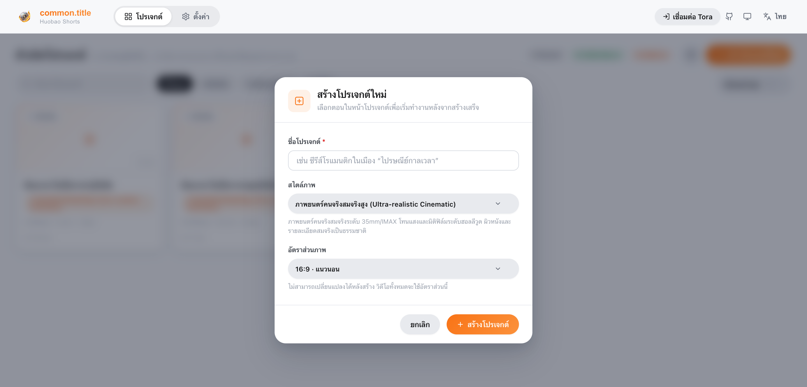

- **ชื่อโปรเจกต์**: เช่น *"ย้อนเวลาไปเป็นราชายุคสุโขทัย"*
- **สไตล์ภาพ**: เลือกลุคภาพยนตร์ที่ต้องการ เช่น **"ภาพยนตร์คนจริงสมจริงระดับ 35mm/IMAX"** โทนแสงและมิติฟิล์มระดับฮอลลีวูด หรือสไตล์ 3D Animation / Anime
- **อัตราส่วนภาพ**: **16:9** (แนวนอน) หรือ **9:16** (แนวตั้งสำหรับ TikTok/Reels)

---

## 📑 ขั้นตอนที่ 3: จัดการตอนและเข้าสู่สตูดิโอผลิต

เมื่อสร้างโปรเจกต์เสร็จ ระบบจะนำเข้าสู่หน้ารายการตอน (Episodes List):

  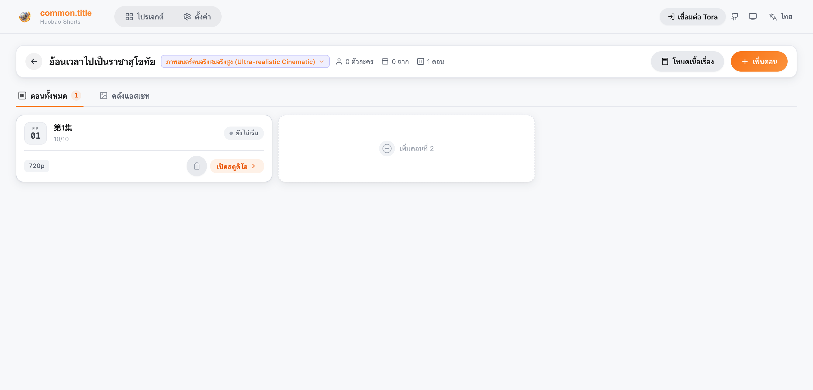

- คลิกปุ่ม **"เปิดสตูดิโอ"** ที่ตอนที่ต้องการ เพื่อเริ่มต้นกระบวนการผลิตสื่อ

---

## ✍️ ขั้นตอนที่ 4: ใส่เนื้อเรื่องย่อสั้นๆ แล้วให้ AI เจนบทละครเต็ม

เมื่อเข้าสู่สตูดิโอ ในแท็บ **"บทละคร" (Script Stage)**:

  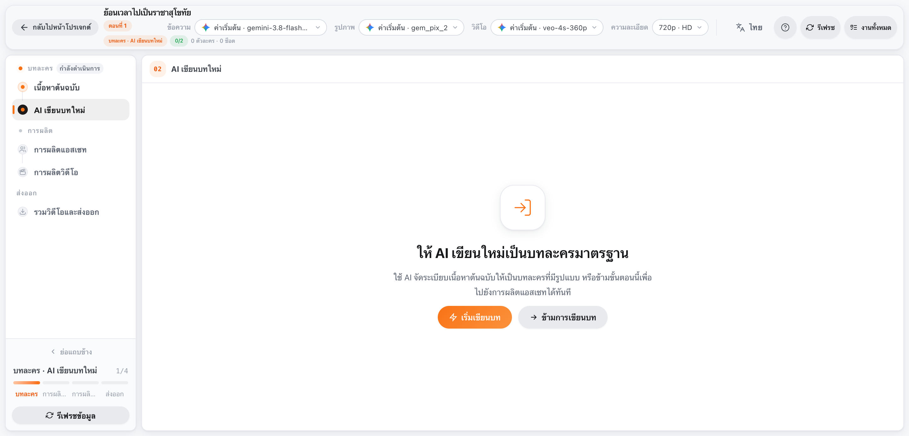

1. วางไอเดีย โครงเรื่องย่อ หรือพล็อตสั้นๆ เพียงไม่กี่ประโยค
2. คลิกปุ่ม **"เริ่มเขียนบท" (AI Rewrite)**
3. ระบบจะขยายเนื้อหาเป็นบทละครโทรทัศน์มาตรฐานภาษาไทยอย่างละเอียด มีทั้งการระบุฉาก (S01, S02), บรรยากาศ, การเคลื่อนไหว, อารมณ์ และบทสนทนา:

  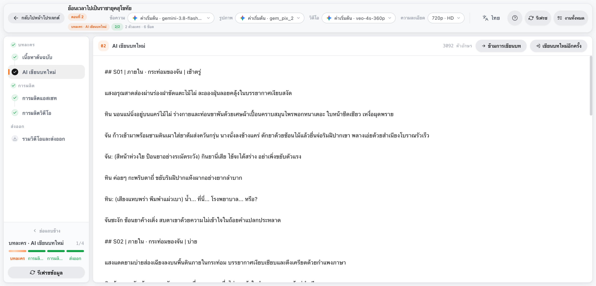

---

## 🎭 ขั้นตอนที่ 5: สกัดสินทรัพย์และสร้างภาพตัวละคร ฉาก อุปกรณ์

สลับไปที่แท็บ **"การผลิตแอสเซท" (Asset Production)**:

  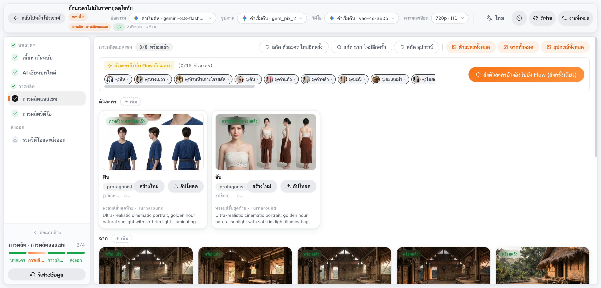

1. คลิกปุ่ม **"สกัดตัวละคร"**, **"สกัดฉาก"**, **"สกัดอุปกรณ์"**
2. ระบบจะสร้าง Character Turnaround Prompt ที่ครอบคลุมทั้ง Close-up ด้านหน้า และ Full-body 3 มุมมอง (หน้า, ข้าง 90 องศา, หลัง) เพื่อล็อกรูปร่างและชุดตัวละครให้คงที่
3. **การรักษาความนิ่งของตัวละคร**:
   - คลิกปุ่ม **"ส่งตัวละครอ้างอิงไปยัง Flow (ส่งครั้งเดียว)"** เพื่อซิงค์รูปตัวละครขึ้น Google Flow
   - หรือคลิกปุ่ม **"อัปโหลด"** เพื่อใส่ภาพ Character ที่คุณวาดหรือเจนไว้แล้วเข้ามาแทนที่

---

## 🎥 ขั้นตอนที่ 6: แตกสตอรี่บอร์ด เลือก Model วิดีโอด้านบน และสั่งสร้าง

สลับไปที่แท็บ **"การผลิตวิดีโอ" (Storyboard & Video Production)**:

  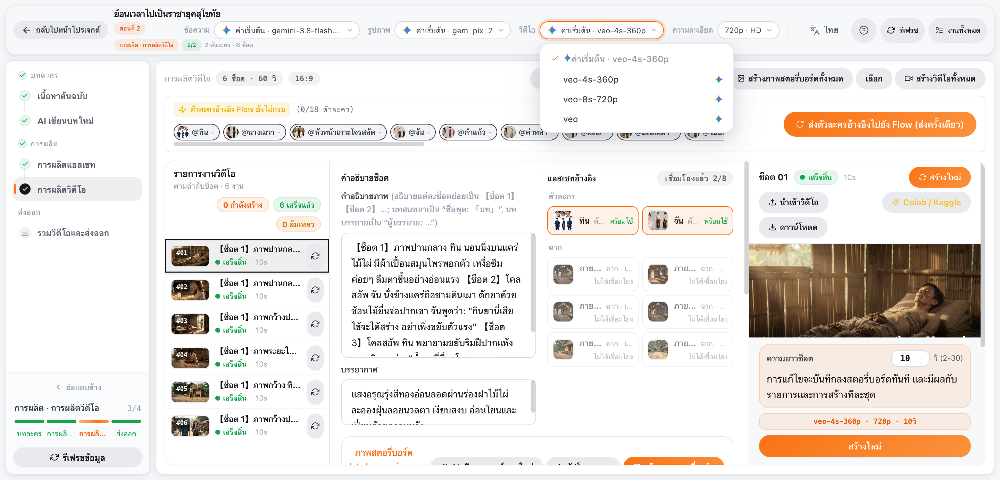

1. คลิกปุ่ม **"แตกสตอรี่บอร์ดใหม่"**: ระบบจะแบ่งฉากออกเป็นช็อตกล้อง (เช่น 6 ช็อต · 60 วินาที)
2. **เลือก Model วิดีโอที่แถบด้านบน**:
   - คลิกที่เมนู Dropdown ด้านบนเพื่อสลับโมเดลได้ทันที: เช่น **Google Flow Veo 2 (`veo-4s-360p`, `veo-8s-720p`, `veo`)**, **Seedance 2.0**, **Alibaba Wan 3.0**, หรือ **MiniMax H3**
3. ระบบจะผูกแอสเซทที่เกี่ยวข้อง (เช่น `@ทิน`, `@จัน`) เข้ากับแต่ละช็อตให้อัตโนมัติ
4. คลิกปุ่ม **"สร้างวิดีโอทั้งหมด"** หรือกดสร้างทีละช็อต

---

## 🎞️ ขั้นตอนที่ 7: ตรวจสอบไทม์ไลน์ รวมวิดีโอด้วย FFmpeg และดาวน์โหลด

สลับไปที่แท็บ **"รวมวิดีโอและส่งออก" (Export & Merge)**:

  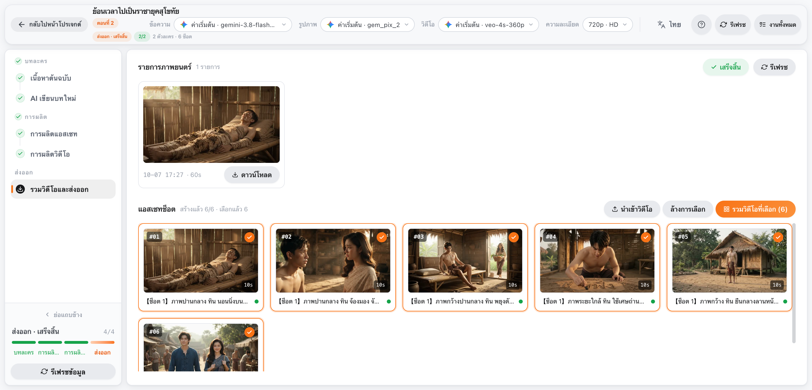

1. **ตรวจสอบความต่อเนื่อง**: พรีวิวดูวิดีโอแต่ละช็อตในไทม์ไลน์
2. คลิกปุ่ม **"รวมวิดีโอที่เลือก"**: FFmpeg ภายในระบบจะปรับขนาดและต่อคลิปทุกช็อตเข้าด้วยกันเป็นไฟล์เดียว
3. เมื่อรวมเสร็จแล้ว สามารถคลิกดูพรีวิวภาพยนตร์ฉบับเต็ม และคลิกปุ่ม **"ดาวน์โหลด"** เพื่อนำไฟล์ `.mp4` ไปเผยแพร่ได้ทันที

---

## 💡 เคล็ดลับขั้นเซียน: การล็อกตัวละคร/ฉากให้นิ่งสนิท และประหยัดค่าใช้จ่าย 100%

หากต้องการความนิ่งของหน้าตาตัวละครแบบเป๊ะ 100% หรือต้องการประหยัดงบประมาณ:

1. **นำ Prompt จากระบบไปเจนข้างนอก**:
   - ในแท็บ **Assets** หรือ **Storyboard** คุณสามารถคัดลอก Prompt ภาษาอังกฤษระดับ Cinematic ที่ระบบแต่งไว้ให้ ไปวางสร้างใน **Midjourney**, **Fooocus**, หรือ **ComfyUI**
2. **ใช้ปุ่มอัปโหลด (Upload / นำเข้าวิดีโอ)**:
   - ที่การ์ดตัวละครแต่ละตัวจะมีปุ่ม **"อัปโหลด"** ให้คุณนำรูปใบหน้าที่ถูกใจที่สุดมาใส่เป็น Reference Image
   - ในหน้า **Export** มีปุ่ม **"นำเข้าวิดีโอ"** และปุ่ม **"เปลี่ยนวิดีโอ"** ให้คุณอัปโหลดคลิปวิดีโอที่สร้างจากภายนอกเข้ามาแทนที่ช็อตนั้นๆ ได้ทันที
3. **ผลลัพธ์ที่ได้**:
   - **ล็อกหน้าตาตัวละคร สีหน้า และมุมกล้องได้นิ่งเป๊ะ 100%** ตามความต้องการของผู้กำกับ
   - **ประหยัดค่าเครดิต API** ในส่วนที่ต้องการทดลองหลายครั้ง
   - **ยังคงใช้งานระบบอัตโนมัติของ Tora StoryVDO ได้ครบถ้วน**: ทั้งการแตกบทสตอรี่บอร์ด การเรียงไทม์ไลน์ และการสั่ง FFmpeg รวมคลิปจบในคลิกเดียว!
