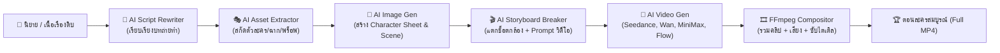
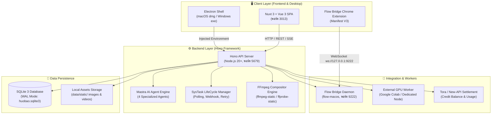
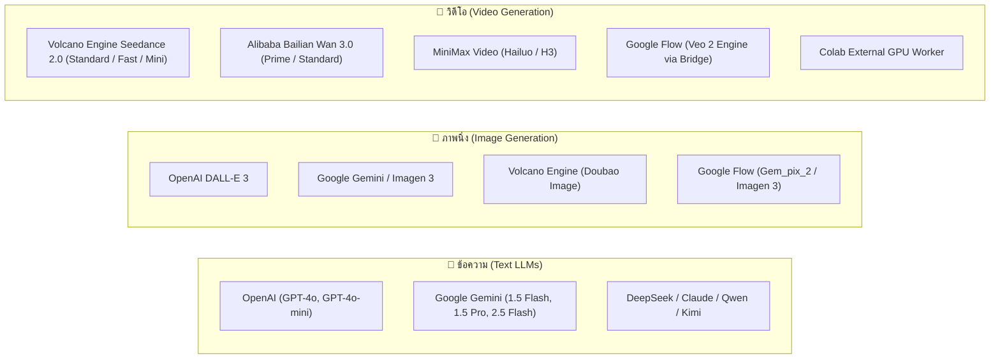
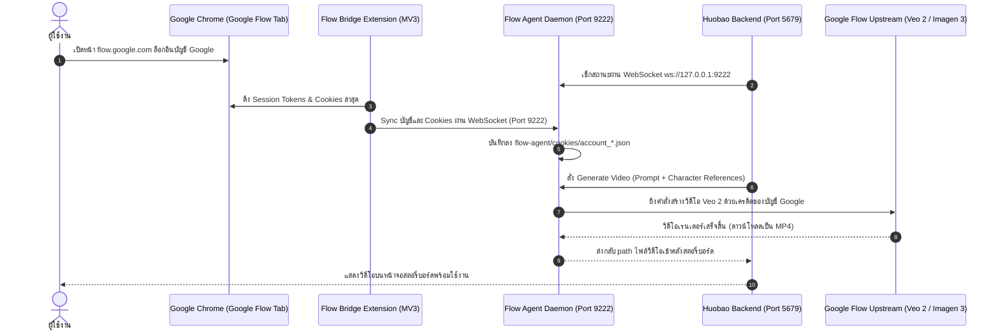
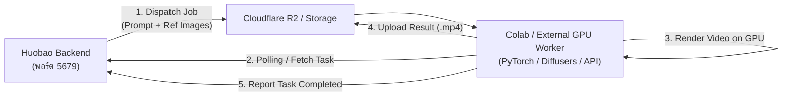

# 🎬 คู่มือและรายละเอียดสถาปัตยกรรมระบบ Huobao Drama (火宝短剧)

> **ฉบับสมบูรณ์ (Full Architecture & Operation Manual)**  
> แพลตฟอร์มผลิตละครสั้นและมังงะวิดีโออัตโนมัติด้วย AI แบบครบวงจร (All-in-One AI Short Drama Production Platform)

---

## 📌 สารบัญ (Table of Contents)
1. [ภาพรวมของระบบและปรัชญาการออกแบบ](#1-ภาพรวมของระบบและปรัชญาการออกแบบ)
2. [สถาปัตยกรรมทางเทคนิค (Tech Stack & Architecture)](#2-สถาปัตยกรรมทางเทคนิค-tech-stack--architecture)
3. [ระบบ AI Multi-Agent Pipeline](#3-ระบบ-ai-multi-agent-pipeline)
4. [ระบบเชื่อมต่อโมเดลสื่อ (Media Generation Hub)](#4-ระบบเชื่อมต่อโมเดลสื่อ-media-generation-hub)
5. [ระบบ Google Flow Bridge & Auto-Pilot (ฟังก์ชันพิเศษ)](#5-ระบบ-google-flow-bridge--auto-pilot-ฟังก์ชันพิเศษ)
6. [คู่มือการใช้งานทีละขั้นตอนพร้อมภาพประกอบ (Step-by-Step Manual)](#6-คู่มือการใช้งานทีละขั้นตอนพร้อมภาพประกอบ-step-by-step-manual)
   - [ขั้นตอนที่ 1: การสร้างโปรเจกต์และกำหนดสไตล์](#ขั้นตอนที่-1-การสร้างโปรเจกต์และกำหนดสไตล์)
   - [ขั้นตอนที่ 2: การตั้งค่า AI Services & Providers](#ขั้นตอนที่-2-การตั้งค่า-ai-services--providers)
   - [ขั้นตอนที่ 3: ขั้นตอนบทละคร (Script Stage & AI Rewrite)](#ขั้นตอนที่-3-ขั้นตอนบทละคร-script-stage--ai-rewrite)
   - [ขั้นตอนที่ 4: การสกัดและผลิตสินทรัพย์ (Asset Extraction & Consistency)](#ขั้นตอนที่-4-การสกัดและผลิตสินทรัพย์-asset-extraction--consistency)
   - [ขั้นตอนที่ 5: การแตกสตอรี่บอร์ดและสร้างวิดีโอ (Storyboard & Video Generation)](#ขั้นตอนที่-5-การแตกสตอรี่บอร์ดและสร้างวิดีโอ-storyboard--video-generation)
   - [ขั้นตอนที่ 6: การรวมคลิปและส่งออก (FFmpeg Merge & Export)](#ขั้นตอนที่-6-การรวมคลิปและส่งออก-ffmpeg-merge--export)
7. [ระบบ Colab Worker & Distributed GPU](#7-ระบบ-colab-worker--distributed-gpu)
8. [ระบบ Multi-User, Data Isolation และระบบเครดิต (Tora / New-API)](#8-ระบบ-multi-user-data-isolation-และระบบเครดิต-tora--new-api)
9. [โครงสร้างฐานข้อมูลและไดเรกทอรีจัดเก็บไฟล์](#9-โครงสร้างฐานข้อมูลและไดเรกทอรีจัดเก็บไฟล์)
10. [แนวทางการดูแลและแก้ปัญหา (Operations & Troubleshooting)](#10-แนวทางการดูแลและแก้ปัญหา-operations--troubleshooting)

---

## 1. ภาพรวมของระบบและปรัชญาการออกแบบ

**Huobao Drama (火宝短剧)** เป็นโซลูชัน Full-Stack ระดับโปรดักชันที่ถูกออกแบบมาเพื่อปฏิวัติวงการผลิตละครสั้น (Short Drama), การ์ตูนขยับได้ (Manga Video) และคอนเทนต์วิดีโอสั้น โดยนำพลังของโมเดลปัญญาประดิษฐ์ (Generative AI) มาร้อยเรียงเข้ากับกระบวนการผลิตสื่อจริงตั้งแต่ต้นน้ำถึงปลายน้ำ



### ปัญหาหลักที่ระบบเข้ามาแก้ไข
1. **ความไม่ต่อเนื่องของตัวละคร (Character Inconsistency)**: การสร้างวิดีโอ AI ทั่วไปมักเกิดปัญหาหน้าตาและชุดของตัวละครเปลี่ยนไปทุกช็อต Huobao Drama แก้ปัญหานี้ด้วยระบบ **Asset Library + Reference Image Injection + Google Flow Character Mapping**
2. **กระบวนการที่กระจัดกระจาย**: ผู้สร้างคอนเทนต์เดิมต้องสลับไปมาระหว่าง ChatGPT (เขียนบท) -> Midjourney (เจนรูป) -> Runway/Kling (เจนวิดีโอ) -> Premiere Pro (ตัดต่อ) Huobao Drama รวมทั้งหมดไว้ในเวิร์กเบนช์หน้าเดียว
3. **การควบคุมต้นทุนและเครดิต**: รองรับทั้ง Local Models, Cloud APIs ชั้นนำ, ระบบเครดิตกลาง (Tora API), Worker GPU อิสระ และการเชื่อมต่อผ่าน Google Flow ฟรีเครดิต

---

## 2. สถาปัตยกรรมทางเทคนิค (Tech Stack & Architecture)

ระบบประกอบด้วยสถาปัตยกรรมแบบแยกส่วน (Decoupled Modular Architecture) ที่เชื่อมโยงกันอย่างมีประสิทธิภาพ:



### รายละเอียดเทคโนโลยีในแต่ละส่วน:
- **Frontend**: พัฒนาด้วย Nuxt 3 (ตั้งค่า `ssr: false`), Vue 3 Composition API, TypeScript ใช้ Pure CSS ที่ออกแบบเฉพาะตัวเพื่อความเร็วในการเรนเดอร์ ไม่พึ่งพาคอมโพเนนต์ไลบรารีขนาดใหญ่
- **Backend API**: พัฒนาด้วย **Hono** บน Node.js ซึ่งมีขนาดเบาและประสิทธิภาพการประมวลผลสูง จัดการ Routing ภายใต้ `/api/v1` และให้บริการไฟล์สถิตผ่าน `/static`
- **Database Layer**: ใช้ **SQLite** ผ่าน `better-sqlite3` ร่วมกับ **Drizzle ORM** รันในโหมด WAL (Write-Ahead Logging) เพื่อรองรับการอ่านเขียนพร้อมกันได้อย่างลื่นไหล ไม่ต้องติดตั้งดาต้าเบสเซิร์ฟเวอร์ภายนอก
- **Post-Production Video Engine**: ติดตั้งไบนารี `ffmpeg-static` และ `ffprobe-static` มาในตัว รองรับการรวมคลิป ปรับสัดส่วน (Letterbox / Pan-Scan) ดึงเฟรมแรก (Poster Frame) และแทรกเสียงโดยไม่ต้องติดตั้ง FFmpeg แยกในระบบปฏิบัติการ

---

## 3. ระบบ AI Multi-Agent Pipeline

ระบบใช้สถาปัตยกรรม **Mastra Agent Framework** โดยแบ่งหน้าที่การทำงานออกเป็น 4 เอเจนต์เฉพาะทาง:

| Agent Name | หน้าที่หลัก | Input | Output | Prompt Template |
|---|---|---|---|---|
| `script_rewriter` | ดัดแปลงเนื้อเรื่อง/นิยายให้อยู่ในฟอร์แมตบทละครสำหรับถ่ายทำ | นิยายดิบ, สไตล์, ข้อมูลเบื้องต้น | บทละครแบ่งตอน พร้อมไดอะล็อกและคำบรรยายฉาก | `workspace/prompts/script_rewriter.th.md` |
| `extractor` | วิเคราะห์บทละครและสกัดรายชื่อเอนทิตีที่ต้องสร้าง | บทละครโทรทัศน์ | รายชื่อตัวละคร (Character), ฉาก (Scene), พร็อพ (Prop) พร้อมคำอธิบายรูปลักษณ์ | `workspace/prompts/extractor.th.md` |
| `storyboard_breaker` | แยกบทละครแต่ละฉากออกเป็นช็อตกล้อง (Shots) | บทของแต่ละตอน | สตอรี่บอร์ดรายช็อต (มุมกล้อง, ขนาดภาพ, แอ็กชัน, ไดอะล็อก) | `workspace/prompts/storyboard_breaker.th.md` |
| `prompt_generator` | แปลงรายละเอียดช็อตและเอนทิตีเป็น Prompt ภาษาอังกฤษสำหรับโมเดลภาพ/วิดีโอ | ข้อมูลสตอรี่บอร์ด + สไตล์ภาพ | Positive Prompt, Negative Prompt, Camera Movements, Tag `@Character` | `workspace/prompts/prompt_generator.th.md` |

---

## 4. ระบบเชื่อมต่อโมเดลสื่อ (Media Generation Hub)

Huobao Drama มี Adapter Pattern ที่ยืดหยุ่น รองรับการสร้างสื่อผ่านผู้ให้บริการชั้นนำ:



---

## 5. ระบบ Google Flow Bridge & Auto-Pilot (ฟังก์ชันพิเศษ)

หนึ่งในฟีเจอร์เด่นที่สุดของระบบที่ได้รับการผสานอย่างแนบเนียนคือการเชื่อมต่อเข้ากับ **Google Flow (`flow.google.com`)**:



### จุดเด่นของ Google Flow Bridge:
1. **ฟรีเครดิตจาก Google**: ใช้งานโมเดลเรือธงอย่าง **Veo 2** และ **Imagen 3** ผ่านเครดิตที่ Google มอบให้ในแพลตฟอร์ม Flow โดยตรง
2. **ระบบดึง Cookie อัตโนมัติ (Zero-Config Session)**: มี Chrome Extension ช่วยจับคู่ Session Token แบบเรียลไทม์ ทำให้ผู้ใช้ไม่ต้องคัดลอก Cookie ด้วยมือ
3. **Character Reference Synchronization**: Huobao Backend จะส่งรูป Reference ของตัวละครไปขึ้นทะเบียนใน Google Flow ล่วงหน้า ทำให้เมื่อสั่งเจนวิดีโอ ตัวละครจะมีหน้าตาเหมือนต้นฉบับอย่างแม่นยำ

---

## 6. คู่มือการใช้งานทีละขั้นตอนพร้อมภาพประกอบ (Step-by-Step Manual)

### ขั้นตอนที่ 1: การสร้างโปรเจกต์และกำหนดสไตล์

เริ่มต้นการสร้างซีรีส์ละครสั้นด้วยการกดปุ่ม **"สร้างโปรเจกต์ใหม่" (New Project)** บนหน้าแดชบอร์ด

<p align="center">
  
</p>

#### การตั้งค่าสำคัญ:
1. **ชื่อเรื่อง (Drama Title)**: ระบุชื่อเรื่องของละคร
2. **อัตราส่วนการแสดงผล (Aspect Ratio)**:
   - **9:16 (แนวตั้ง)**: เหมาะสำหรับ TikTok, YouTube Shorts, Reels, Kuaishou, Douyin
   - **16:9 (แนวนอน)**: เหมาะสำหรับ YouTube, TV Series, แพลตฟอร์มสตรีมมิ่งทั่วไป
   *(หมายเหตุ: เมื่อเลือกแล้วจะไม่สามารถเปลี่ยนอัตราส่วนระหว่างโปรเจกต์ได้)*
3. **สไตล์ภาพ (Visual Style)**: เลือกลุคแอนด์ฟีลของเรื่อง เช่น 3D Animation, Real-life Cinematic, Anime, Cyberpunk โดยสไตล์ที่เลือกนี้จะถูกระบบแทรกเข้าไปเป็นแกนหลักของ Prompt ทุกรูปและทุกวิดีโอโดยอัตโนมัติ

เมื่อสร้างเสร็จ ระบบจะนำคุณเข้าสู่หน้ารายการโปรเจกต์:

<p align="center">
  
</p>

---

### ขั้นตอนที่ 2: การตั้งค่า AI Services & Providers

ก่อนเริ่มสร้างชิ้นงาน ให้ไปที่เมนู **"ตั้งค่า" (Settings)** เพื่อกำหนดโมเดล AI ที่ต้องการใช้งาน

<p align="center">
  
</p>

#### วิธีการตั้งค่า 2 รูปแบบ:
1. **Huobao Quick Setup**: เพียงวาง API Key ตัวเดียวจากระบบ Huobao / Firemux หรือ Tora ระบบจะกำหนดค่า Text, Image, และ Video Models ที่แนะนำให้ทันทีในคลิกเดียว
2. **Manual Configuration**: กำหนดค่าแยกตาม Provider ได้อย่างอิสระ ไม่ว่าจะเป็น OpenAI, Google Gemini, Volcano Engine, MiniMax, Alibaba Wan หรือ Google Flow

---

### ขั้นตอนที่ 3: ขั้นตอนบทละคร (Script Stage & AI Rewrite)

คลิกเข้าสู่ตอนที่ต้องการผลิตในหน้ารายการตอน:

<p align="center">
  
</p>

นำเนื้อเรื่อง นิยายต้นฉบับ หรือเรื่องย่อมาวางในหน้า **Script Stage**:

<p align="center">
  
</p>

- คลิกปุ่ม **"AI Rewrite"** เพื่อให้เอเจนต์แปลงข้อความเป็นบทโทรทัศน์มาตรฐาน
- ระบบจะระบุบทพูด (Dialogue), อารมณ์ความรู้สึก, การกระทำ (Action), สภาพแวดล้อม และตัวละครที่ปรากฏในฉากให้อัตโนมัติ

---

### ขั้นตอนที่ 4: การสกัดและผลิตสินทรัพย์ (Asset Extraction & Consistency)

เมื่อได้บทที่สมบูรณ์แล้ว ให้คลิกแท็บ **"Assets" (สินทรัพย์)**:

<p align="center">
  
</p>

1. คลิก **"AI Extract Assets"**: ระบบจะวิเคราะห์บทและแยกรายการตัวละคร (Characters), ฉากหลัง (Scenes) และอุปกรณ์สำคัญ (Props)
2. คลิก **"Generate"** หรือ **"Batch Generate"**: AI จะวาดรูป Character Design Sheet และภาพบรรยากาศฉากออกมา
3. **รูปภาพอ้างอิง (Reference Consistency)**: รูปที่สร้างขึ้นหรืออัปโหลดเข้ามานี้ จะถูกใช้เป็นภาพอ้างอิงตั้งต้น (Image-to-Video Reference) ในขั้นตอนสร้างวิดีโอ ทำให้ตัวละครคงรูปลักษณ์เดิมตลอดทั้งเรื่อง

---

### ขั้นตอนที่ 5: การแตกสตอรี่บอร์ดและสร้างวิดีโอ (Storyboard & Video Generation)

เข้าสู่ขั้นตอนที่สำคัญที่สุดคือแท็บ **"Storyboard & Video Production"**:

<p align="center">
  
</p>

1. **AI Storyboard Breakdown**: คลิกปุ่มเพื่อแตกฉากออกเป็นช็อตกล้อง (Camera Shots) เช่น ช็อตโคลสอัพ (Close-up), มุมกว้าง (Wide Shot), ช็อตติดตาม (Tracking Shot)
2. ตรวจสอบ Prompt ในแต่ละช็อต โดยระบบจะดึงแท็ก `@Character` มาจับคู่กับรูป Reference ของตัวละครให้อัตโนมัติ
3. สั่งสร้างวิดีโอ: สามารถเลือกสร้างทีละช็อต หรือกด **"Batch Generate Videos"**

<p align="center">
  
</p>

- หน้าจอจะแสดงสถานะความคืบหน้าของงาน (Pending ➜ Generating ➜ Completed)
- หากมีช็อตใดที่โมเดลเรนเดอร์ไม่ถูกใจ สามารถกดปุ่ม **"Regenerate"** หรือแก้ไข Prompt เฉพาะช็อตนั้นได้ทันที

---

### ขั้นตอนที่ 6: การรวมคลิปและส่งออก (FFmpeg Merge & Export)

เมื่อคลิปวิดีโอในแต่ละช็อตเรนเดอร์เสร็จสมบูรณ์แล้ว ให้เข้าสู่แท็บ **"Export" (รวมคลิปและส่งออก)**:

<p align="center">
  
</p>

1. **ตรวจสอบความต่อเนื่อง (Timeline Preview)**: สามารถเลื่อนเมาส์พรีวิวเนื้อหาวิดีโอแต่ละช็อต เรียงลำดับ หรือสลับคลิปสำรองได้
2. **Start Merging**: คลิกปุ่มรวมวิดีโอ ระบบจะส่งคำสั่งไปยัง Engine FFmpeg ภายในตัวเครื่องเพื่อ:
   - ปรับความละเอียดและเฟรมเรตของทุกคลิปให้เท่ากันแบบไร้รอยต่อ
   - ผสานคลิปตามลำดับช็อต
   - ฝังเสียงและจัดวางซับไตเติล
3. **Download & Publish**: เมื่อรวมเสร็จ สามารถกดเล่นไฟล์เต็มบนเบราว์เซอร์ และคลิกปุ่ม **"Download Video"** เพื่อนำไฟล์ `.mp4` ไปเผยแพร่ได้ทันที

---

## 7. ระบบ Colab Worker & Distributed GPU

สำหรับผู้ใช้ที่ต้องการสร้างวิดีโอความละเอียดสูงด้วยโมเดลหนัก (เช่น MiniMax H3 หรือ Alibaba Wan) โดยไม่มี GPU แรงในเครื่อง:



- มีหน้าต่าง **ColabVideoModal** บน UI เพื่ออำนวยความสะดวกในการกดส่งงานไปยัง Worker ภายนอก
- รองรับการทำงานแบบ Asynchronous Background Task ไม่บล็อกการทำงานส่วนอื่นของแอป

---

## 8. ระบบ Multi-User, Data Isolation และระบบเครดิต (Tora / New-API)

ในเวอร์ชันปัจจุบัน ระบบได้รับการอัปเกรดให้รองรับการทำงานแบบ Multi-User และระบบจัดสรรโควตาเครดิต:

1. **User Authentication & Isolation**:
   - รองรับระบบล็อกอินผ่าน JWT / Session Tokens
   - มีคอมโพเนนต์ **UserBadge** แสดงชื่อบัญชีและสถานะที่มุมขวาบน
   - ข้อมูลโปรเจกต์ (Drama), ตอน (Episode) และงานสร้างสื่อ (SysTask) จะถูกผูกกับ `ownerUserId` อย่างเคร่งครัด ผู้ใช้แต่ละคนจะไม่เห็นงานของกันและกัน
2. **ระบบคิดเครดิต Tora / New-API (`toraapi.com`)**:
   - ระบบคำนวณเครดิตจาก **วินาทีของวิดีโอผลลัพธ์ที่สร้างสำเร็จจริง × ราคาตามโมเดลและความละเอียด**
   - งานที่ล้มเหลว (Failed / Cancelled) จะไม่มีการหักเครดิตใดๆ ทั้งสิ้น

---

## 9. โครงสร้างฐานข้อมูลและไดเรกทอรีจัดเก็บไฟล์

### ตารางหลักในฐานข้อมูล SQLite (`data/huobao.sqlite3`):
- `users`: บัญชีผู้ใช้งานและ Token สิทธิ์
- `dramas`: ข้อมูลโปรเจกต์ซีรีส์, สไตล์, อัตราส่วนภาพ, เจ้าของ
- `episodes`: ตอนของละคร, บทโทรทัศน์, สถานะความคืบหน้า
- `characters` / `scenes` / `props`: สินทรัพย์อ้างอิงที่สกัดได้
- `storyboards`: รายละเอียดช็อตกล้อง, Prompt, วิดีโอ URL, สถานะ
- `sys_task`: ประวัติและสถานะคิวการสร้างสื่อ (Pending, Processing, Succeeded, Failed)
- `ai_service_configs`: การตั้งค่าผู้ให้บริการโมเดล AI แต่ละตัว

### โครงสร้างโฟลเดอร์สำหรับจัดเก็บไฟล์สื่อ (`data/static/`):
```
data/
├── huobao.sqlite3        # ฐานข้อมูลหลัก (SQLite + WAL)
└── static/
    ├── images/           # รูป Character Design และ Scene Reference
    ├── videos/           # คลิปวิดีโอรายช็อตที่สร้างจาก AI
    └── merged/           # ไฟล์วิดีโอฉบับเต็มของตอนที่รวมผ่าน FFmpeg แล้ว
```

---

## 10. แนวทางการดูแลและแก้ปัญหา (Operations & Troubleshooting)

### 1. คำสั่งสำหรับเริ่มต้นการทำงาน (Developer & Server Commands):
```bash
# รัน Backend (Hono + TypeScript)
cd backend && npm run dev

# รัน Frontend (Nuxt 3 Dev Server)
cd frontend && npm run dev

# รัน Flow Bridge (สำหรับการเชื่อมต่อ Google Flow)
cd flow-drama-autopilot/flow-agent-ref/flow-agent
./bin/flow bridge
```

### 2. การตรวจสอบสถานะระบบ Google Flow (Self-Diagnostics):
```bash
cd flow-drama-autopilot/flow-agent-ref/flow-agent
./bin/flow doctor
```
ผลลัพธ์ที่ถูกต้องควรแสดง:
- `ok cookies`: พบคุกกี้ที่ถูกต้องและสดใหม่
- `ok session`: upstream accepted the session — มีจำนวนเครดิตพร้อมใช้งาน
- `ok database`: ระบบฐานข้อมูล Flow Agent พร้อมทำงาน

### 3. กรณี Session ของ Google Flow หมดอายุ (401 Expired):
- เปิดเบราว์เซอร์ Google Chrome ไปที่ `https://flow.google.com`
- เปิดหน้าต่างทิ้งไว้ เพื่อให้ส่วนขยาย **Flow Bridge Extension** ดึงคุกกี้ใหม่และซิงค์กลับมายัง `flow bridge` อัตโนมัติ
