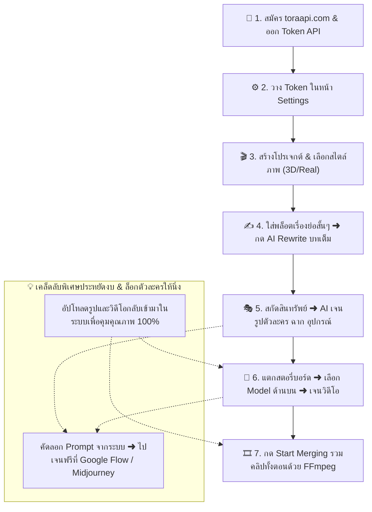
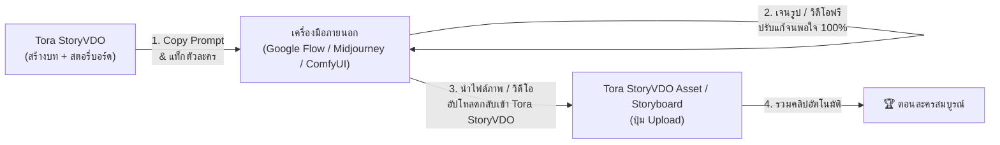

# 📖 คู่มือแนะนำการใช้งาน Tora StoryVDO (ฉบับเริ่มต้นจนสร้างคลิปสำเร็จ)

> **คู่มือสรุปขั้นตอนการทำงาน (Step-by-Step Quick Guide)**  
> วิธีตั้งค่า Token จาก **toraapi.com** สู่การสร้างซีรีส์ละครสั้นด้วย AI พร้อมเทคนิคล็อกตัวละครและประหยัดงบประมาณ

---

## 🧭 แผนผังกระบวนการทำงานภาพรวม (Workflow Overview)

---

## 🔑 ขั้นตอนที่ 1: สมัครสมาชิกและออก Token จาก `toraapi.com`

ระบบใช้ระบบจัดการเครดิตกลางผ่าน **Tora API (`toraapi.com`)** ซึ่งช่วยให้คุณใช้ API Key เดียวควบคุมการสร้างทั้งข้อความ ภาพนิ่ง และวิดีโอได้

1. เข้าไปที่เว็บไซต์: **[https://toraapi.com](https://toraapi.com)** (หรือ `https://www.toraapi.com`)
2. ทำการ **สมัครสมาชิก (Register)** หรือ **เข้าสู่ระบบ (Sign in)**
3. ไปที่เมนู **"โทเค็น" / "API Keys" (令牌管理)** ในแถบด้านข้าง
4. คลิกปุ่ม **"สร้างโทเค็นใหม่" (Add Token / 添加令牌)**:
   - **ชื่อ (Name)**: ตั้งชื่อที่จำง่าย เช่น `Tora StoryVDO-Drama`
   - **โควตา (Quota)**: กำหนดเครดิตที่ต้องการ หรือเลือกแบบไม่จำกัดตามแพ็กเกจที่คุณเติม
5. เมื่อสร้างเสร็จ ให้คลิก **คัดลอก (Copy)** รหัส Token (จะมีรูปแบบขึ้นต้นด้วย `sk-...`)

---

## ⚙️ ขั้นตอนที่ 2: นำ Token มาใส่ในหน้าตั้งค่า (Settings)

กลับมาที่แอปพลิเคชัน **Tora StoryVDO**:

  

1. คลิกที่ไอคอนเฟือง **"ตั้งค่า" (Settings)** ในเมนูด้านซ้าย
2. ไปที่หัวข้อ **"AI Services"**
3. **การตั้งค่าแบบด่วน (Quick Setup)**:
   - เลือกแท็บ **Firemux / Relay** หรือแท็บผู้ให้บริการของคุณ
   - นำ Token `sk-...` ที่คัดลอกมาจาก `toraapi.com` มาวางในช่อง **API Key**
   - *(กรณีใช้โหนด Tora โดยตรง)*: สามารถสร้างในช่อง **Manual Configuration** โดยใส่ Base URL เป็น `https://toraapi.com`
   - คลิกปุ่ม **"ใช้การตั้งค่านี้" (Apply Quick Config)**
4. ระบบจะเชื่อมต่อและเปิดใช้งานโมเดลสร้างข้อความ ภาพ และวิดีโอให้พร้อมทำงานทันที!

> [!TIP]
> **สายฟรีหรือเน้นประหยัด**: คุณสามารถเปิดใช้แท็บ **Google Flow** หรือ **Google Gemini** เพื่อใช้งานฟรีเครดิตร่วมด้วยได้อีกด้วย

---

## 🎬 ขั้นตอนที่ 3: สร้างโปรเจกต์ใหม่และกำหนดสไตล์หนัง

1. ไปที่หน้าหลักของระบบ แล้วคลิกปุ่ม **"สร้างโปรเจกต์ใหม่" (New Project)**
2. กำหนดรายละเอียดสำคัญของซีรีส์:

  

- **ชื่อเรื่อง (Title)**: เช่น *"บัลลังก์รักทายาทมาเฟีย"*
- **อัตราส่วนหน้าจอ (Aspect Ratio)**:
  - **9:16 (แนวตั้ง)**: สำหรับลง TikTok, Reels, YouTube Shorts, Douyin
  - **16:9 (แนวนอน)**: สำหรับซีรีส์ภาพยนตร์แนวนอน YouTube
- **สไตล์ภาพ (Visual Style)**: เลือกสไตล์ที่ต้องการ เช่น **3D Animation**, **Cinematic Realistic (คนจริงสมจริง)**, หรือ **Anime**
  *(สไตล์นี้จะถูกนำไปเป็นแกนหลักเพื่อล็อกอารมณ์และโทนภาพของทั้งเรื่อง)*

เมื่อสร้างเสร็จ โปรเจกต์จะปรากฏในหน้ารายการ:

  

---

## ✍️ ขั้นตอนที่ 4: กำหนดเนื้อเรื่องย่อสั้นๆ แล้วให้ AI เจนบทเต็ม

คลิกเข้าสู่โปรเจกต์ และเลือกตอนที่ต้องการ (Episode):

  

เข้าสู่หน้า **Script Stage (ขั้นตอนบท)**:

  

1. คุณ**ไม่จำเป็นต้องพิมพ์บทยาวเหยียดด้วยตัวเอง** เพียงแค่พิมพ์เนื้อเรื่องย่อหรือพล็อตสั้นๆ 2-3 ประโยคลงในช่อง เช่น:
   > *"พระเอกเป็นมหาเศรษฐีปลอมตัวเป็นพนักงานส่งของ เดินเข้าไปในงานเลี้ยงตระกูลใหญ่เพื่อทวงคืนของดูต่างหน้าแม่ แต่นางเอกเข้ามาช่วยไว้เพราะนึกว่าเป็นคนไร้ทางสู้"*
2. คลิกปุ่ม **"AI Rewrite" (เขียนบทด้วย AI)**
3. ระบบจะรัน Agent ขยายเนื้อหาออกมาเป็นบทละครถ่ายทำอย่างละเอียด มีทั้งบทพูด (Dialogue), อารมณ์, ท่าทาง และการบอกลำดับฉากอย่างสมบูรณ์แบบ

---

## 🎭 ขั้นตอนที่ 5: สกัดสินทรัพย์ (ตัวละคร, ฉาก, อุปกรณ์)

เมื่อได้บทละครแล้ว ให้สลับไปที่แท็บ **"Assets" (สินทรัพย์)**:

  

1. คลิกปุ่ม **"AI Extract Assets"**: AI จะสแกนบทและสกัดสิ่งที่ต้องใช้ในตอนนี้ออกมาให้อัตโนมัติ:
   - **ตัวละคร (Characters)**: พระเอก, นางเอก, ตัวร้าย (พร้อมระบุอายุ หน้าตา เสื้อผ้า)
   - **ฉาก (Scenes)**: คฤหาสน์หรูหรา, หน้าร้านสะดวกซื้อ, ห้องทำงาน
   - **อุปกรณ์ (Props)**: แหวนประจำตระกูล, มอเตอร์ไซค์ส่งของ
2. คลิกปุ่ม **"Batch Generate"** หรือกด **Generate** ทีละตัว: AI จะทำการวาดรูป Character Sheet และภาพสถานที่ออกมา
3. **ความสำคัญของขั้นตอนนี้**: ภาพตัวละครที่สร้างขึ้นนี้จะกลายเป็น **Reference Image (ภาพต้นแบบ)** ที่ระบบจะนำไปส่งต่อให้โมเดลวิดีโอ เพื่อให้หน้าตาตัวละครไม่เพี้ยนในทุกๆ ช็อต!

---

## 🎥 ขั้นตอนที่ 6: แตกสตอรี่บอร์ด เลือกโมเดลวิดีโอ และสั่งสร้าง

เข้าสู่แท็บ **"Storyboard & Video Production"**:

  

1. คลิกปุ่ม **"AI Storyboard Breakdown"**: ระบบจะแยกบทละครออกเป็นช็อตกล้องตามลำดับเวลา เช่น ช็อตที่ 1 โคลสอัพใบหน้าพระเอก, ช็อตที่ 2 มุมกว้างเห็นห้องจัดเลี้ยง
2. **เลือกโมเดลวิดีโอ (Model Selection)** ที่แถบด้านบนของหน้าจอ:
   - **Seedance 2.0 (Volcano Engine)**: การเคลื่อนไหวสมจริง คมชัด นิยมใช้ทำละครสั้น
   - **Wan 3.0 (Alibaba Bailian)**: โมเดลคุณภาพสูง รองรับสไตล์อนิเมะและภาพยนตร์
   - **MiniMax Video (Hailuo / H3)**: โมเดลยอดนิยมด้านการแสดงสีหน้าและอารมณ์
   - **Google Flow (Veo 2)**: ใช้งานผ่าน Flow Bridge ด้วยเครดิตฟรีของ Google
3. ตรวจสอบ Prompt ในแต่ละช็อต (ระบบจะใส่แท็ก `@Character` เพื่อเชื่อมรูปอ้างอิงให้เสร็จสรรพ)
4. คลิกปุ่ม **"Batch Generate Videos"** เพื่อสร้างวิดีโอทุกช็อตพร้อมกัน หรือกดสร้างทีละช็อต

  

---

## 🎞️ ขั้นตอนที่ 7: รวมคลิปวิดีโอเป็นตอนเต็ม (Merge & Export)

เมื่อวิดีโอทุกช็อตเรนเดอร์เสร็จสิ้น ให้ไปที่แท็บ **"Export" (รวมคลิปและส่งออก)**:

  

1. เลื่อนเมาส์พรีวิวตรวจเช็กความต่อเนื่องของแต่ละช็อตในไทม์ไลน์
2. คลิกปุ่ม **"Start Merging" (เริ่มรวมวิดีโอ)**
3. เครื่องยนต์ **FFmpeg** ที่ฝังอยู่ในตัวโปรแกรมจะทำงานให้อัตโนมัติ:
   - ปรับเฟรมเรตและขนาดของทุกช็อตให้เท่ากัน
   - นำคลิปมาต่อกันอย่างราบรื่น
   - แทรกเสียงและซับไตเติล
4. เมื่อเรนเดอร์เสร็จแล้ว กดดูพรีวิวบนเบราว์เซอร์ และกดปุ่ม **"Download Video"** เพื่อนำไฟล์วิดีโอ `.mp4` ฉบับสมบูรณ์ไปโพสต์ลงโซเชียลมีเดียได้ทันที!

---

## 💡 เคล็ดลับขั้นเซียน: วิธีประหยัดค่าใช้จ่าย & ล็อกหน้าตัวละครให้นิ่ง 100%

หากคุณ**ไม่อยากจ่ายค่าเครดิต API เยอะ** หรือต้องการให้**ใบหน้าตัวละครและฉากนิ่งเป๊ะตามสั่ง 100%** โดยไม่มีอาการหน้าเปลี่ยน:

### 1. ใช้ประโยชน์จาก Google Flow ฟรีเครดิต:
- เปิด `flow.google.com` บน Google Chrome แล้วเปิด `flow bridge`
- ระบบจะดึงเครดิตฟรีของ Google มาสร้างภาพนิ่ง (Imagen 3) และวิดีโอ (Veo 2) ผ่าน Tora StoryVDO ได้โดยตรง โดยไม่ต้องเสียเงินซื้อเครดิต API เพิ่ม

### 2. นำ Prompt ไปสร้างข้างนอกแล้วอัปโหลดกลับเข้ามา (Manual Hybrid Workflow):
- **ขั้นตอนรูปตัวละคร / ฉาก**: คัดลอก Prompt จากแท็บ Assets ไปเจนใน **Midjourney**, **Fooocus**, หรือ **ComfyUI** เพื่อคุมหน้าตาตัวละครให้สวยเป๊ะตามต้องการ ➜ จากนั้นคลิกปุ่ม **"Upload"** ในช่องตัวละครนั้นๆ เพื่อใส่รูปเข้าไปแทนที่
- **ขั้นตอนวิดีโอ**: หากมีช็อตที่ต้องการความแม่นยำสูง สามารถคัดลอก Prompt และรูป Reference ไปสั่งขยับในเว็บวิดีโอ AI ที่คุณมีแพ็กเกจบุฟเฟต์อยู่แล้ว ➜ แล้วกดปุ่ม **"Upload Video"** หรือนำลิงก์มาผูกเข้ากับช็อตนั้นในหน้า Storyboard
- **ข้อดี**: 
  1. **ประหยัดค่าใช้จ่าย**: ไม่ต้องเสียเครดิตรายวินาทีสำหรับช็อตที่ต้องลองหลายครั้ง
  2. **ควบคุมคุณภาพได้ 100%**: ได้ภาพและมุมกล้องที่ถูกต้องตามใจผู้กำกับ
  3. **ยังคงได้ประโยชน์จากระบบรวมอัตโนมัติ**: ยังใช้ Tora StoryVDO ช่วยร้อยเรียงไทม์ไลน์ ลำดับเสียง และกดรวมเป็นไฟล์เต็มด้วย FFmpeg ได้สะดวกเหมือนเดิม!
