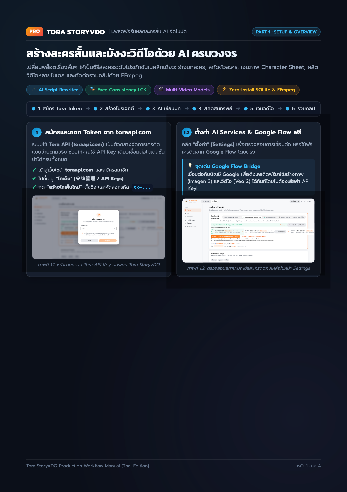
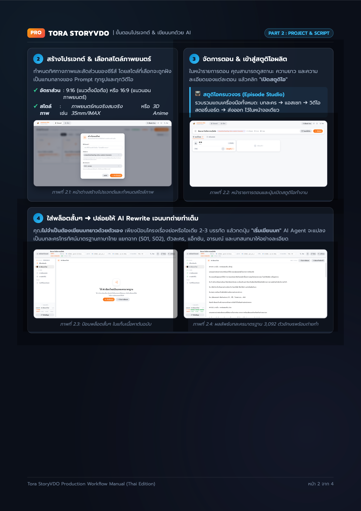
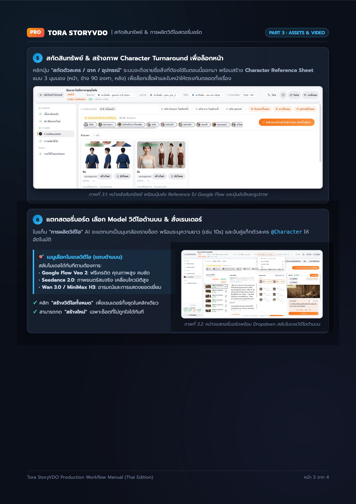
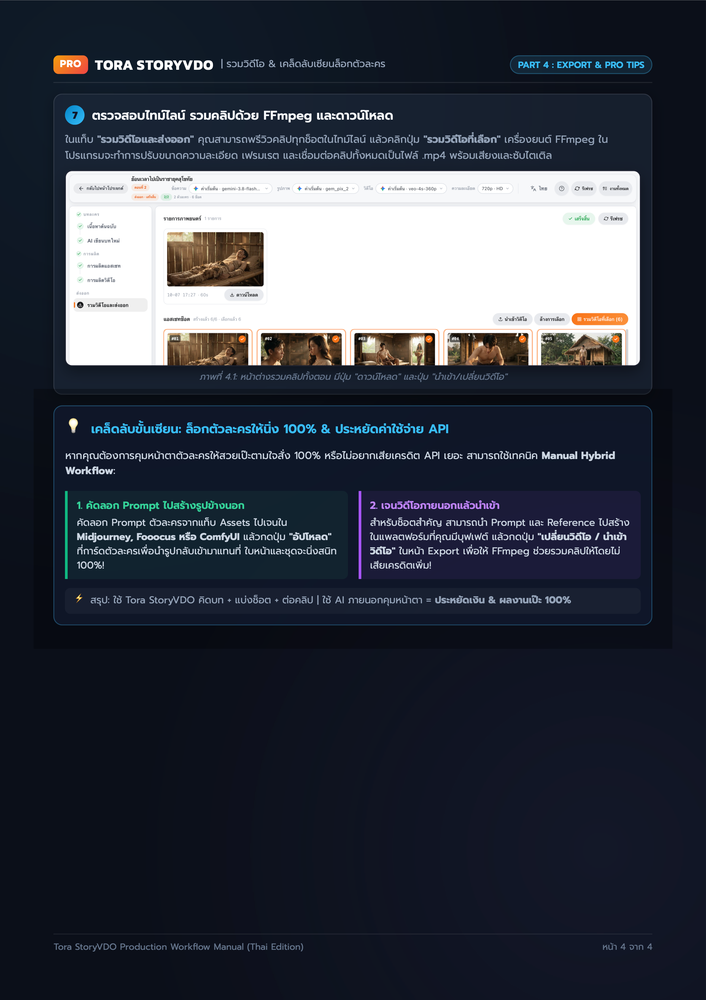

# 🎬 โบรชัวร์คู่มือแนะนำการใช้งาน Tora StoryVDO (Thai Edition)

> **เอกสารพรีเมียมฉบับเต็ม 4 หน้า (High-Resolution A4 Brochure & PDF)**  
> ดาวน์โหลดไฟล์ PDF: **[TORA_STORYVDO_BROCHURE_TH.pdf](TORA_STORYVDO_BROCHURE_TH.pdf)**

---

## 📖 แกลเลอรีหน้าโบรชัวร์ฉบับสมบูรณ์ (Brochure Pages)

### หน้าที่ 1: ภาพรวมระบบและการเชื่อมต่อ Tora API

  

### หน้าที่ 2: การสร้างโปรเจกต์และการเขียนบทด้วย AI

  

### หน้าที่ 3: การสกัดสินทรัพย์และการผลิตวิดีโอสตอรี่บอร์ด

  

### หน้าที่ 4: การรวมคลิปด้วย FFmpeg และเคล็ดลับเซียนล็อกตัวละคร

  

---

## 📑 สรุปเนื้อหาสำคัญในโบรชัวร์แต่ละหน้า

### 📄 หน้าที่ 1: จุดเริ่มต้นและการเชื่อมต่อ API
- **ภาพรวมกระบวนการ 6 ขั้นตอน**: จากพล็อตเรื่องสั้นสู่ไฟล์ภาพยนตร์เต็มเรื่อง
- **วิธีสมัครและออก Token จาก [toraapi.com](https://toraapi.com)**: วิธีสร้าง API Key `sk-...` และการนำมากรอกในระบบ
- **การใช้ฟรีเครดิตผ่าน Google Flow**: ตรวจสอบเครดิตคงเหลือ 649 credits และสลับบัญชีได้ทันที

### 📄 หน้าที่ 2: การตั้งค่าโปรเจกต์ & เขียนบทด้วย AI
- **สร้างโปรเจกต์ใหม่**: กำหนดสัดส่วน 9:16 (TikTok/Reels) หรือ 16:9 (ภาพยนตร์)
- **ล็อกสไตล์ภาพ**: เช่น *ภาพยนตร์คนจริงสมจริงระดับ 35mm/IMAX* หรือ *3D Animation* เพื่อให้โทนภาพทั้งเรื่องสอดคล้องกัน
- **AI Rewrite จากพล็อตสั้นๆ**: วางพล็อตแค่ 2-3 บรรทัด แล้วกดเริ่มเขียนบท AI จะขยายเป็นบทละครโทรทัศน์มาตรฐาน 3,092 ตัวอักษร (S01-S04 แยกอารมณ์ บทพูด และฉาก)

### 📄 หน้าที่ 3: การสกัดสินทรัพย์ & สตอรี่บอร์ดวิดีโอ
- **สกัดตัวละครและฉาก**: สร้าง Character Turnaround Sheet 3 มุมมอง (หน้า, ข้าง 90°, หลัง) เพื่อล็อกเสื้อผ้าและใบหน้า
- **เลือก Model วิดีโอด้านบน**: สลับใช้ Google Flow Veo 2, Volcano Engine Seedance 2.0, Alibaba Wan 3.0 หรือ MiniMax H3
- **คำสั่ง Batch Generate**: เรนเดอร์วิดีโอทุกช็อตพร้อมกันในคลิกเดียว

### 📄 หน้าที่ 4: การรวมคลิป & เคล็ดลับขั้นเซียน
- **FFmpeg Auto-Merge**: ปรับขนาดและรวมคลิปทุกช็อตเป็นไฟล์ `.mp4` พร้อมเสียงและซับไตเติล
- **💡 เคล็ดลับเซียนประหยัดงบและล็อกตัวละครให้นิ่ง 100% (Manual Hybrid Workflow)**:
  1. คัดลอก Prompt จากระบบไปสร้างรูปตัวละครใน **Midjourney / Fooocus / ComfyUI** แล้วกด **"อัปโหลด"** นำรูปกลับเข้ามา
  2. เจนวิดีโอจากเว็บภายนอกที่คุณมีบุฟเฟต์ แล้วกด **"เปลี่ยนวิดีโอ / นำเข้าวิดีโอ"** ในหน้า Export
  3. ผลลัพธ์: **ใบหน้าตัวละครนิ่งสนิท 100% ไม่เสียเครดิตเพิ่ม และยังใช้ระบบต่อคลิปอัตโนมัติของ Tora StoryVDO ได้สมบูรณ์แบบ**

---

## 📥 ลิงก์ดาวน์โหลดไฟล์ทั้งหมด

| รายการ | รูปแบบไฟล์ | ลิงก์เปิดไฟล์ |
|---|---|---|
| 📕 **โบรชัวร์ Tora StoryVDO ฉบับสมบูรณ์ (4 หน้า A4)** | PDF | [TORA_STORYVDO_BROCHURE_TH.pdf](TORA_STORYVDO_BROCHURE_TH.pdf) |
| 🖼️ **ภาพโบรชัวร์หน้าที่ 1 (Overview & Setup)** | PNG (2x Retina) | [live-guide-screens/brochure-page-1.png](live-guide-screens/brochure-page-1.png) |
| 🖼️ **ภาพโบรชัวร์หน้าที่ 2 (Project & Script)** | PNG (2x Retina) | [live-guide-screens/brochure-page-2.png](live-guide-screens/brochure-page-2.png) |
| 🖼️ **ภาพโบรชัวร์หน้าที่ 3 (Assets & Video)** | PNG (2x Retina) | [live-guide-screens/brochure-page-3.png](live-guide-screens/brochure-page-3.png) |
| 🖼️ **ภาพโบรชัวร์หน้าที่ 4 (Export & Pro Tips)** | PNG (2x Retina) | [live-guide-screens/brochure-page-4.png](live-guide-screens/brochure-page-4.png) |
| 🌐 **แม่แบบต้นฉบับสำหรับการพิมพ์ (Master HTML)** | HTML | [brochure.html](brochure.html) |
