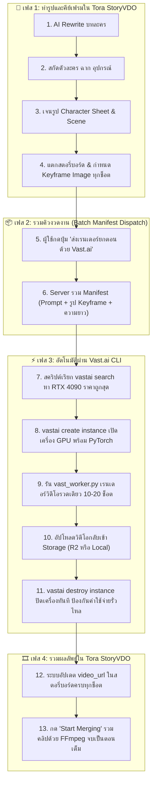

# 🚀 แผนสถาปัตยกรรม: ทำรูปก่อน ➜ ส่งเรนเดอร์วิดีโอยกตอนด้วย Vast.ai CLI

> **ยกระดับ Tora StoryVDO สู่ระบบ Distributed GPU Batch Rendering**  
> แก้ปัญหาหน้าตัวละครเพี้ยน + ประหยัดต้นทุนเหลือเพียง ~5-10 บาทต่อตอน ด้วยการเช่า GPU ผ่าน **Vast.ai CLI** (`https://cloud.vast.ai/cli/`)

---

## 📌 บทนำและเหตุผลทางเทคนิค (Why This Architecture?)

การผลิตวิดีโอ AI ในปัจจุบันพบปัญหาใหญ่ 2 ประการ:
1. **การสร้าง Text-to-Video โดยตรง**: โมเดลวิดีโอจะสุ่มสร้างหน้าตาและฉากใหม่ทุกช็อต ทำให้หน้าตัวละครและเสื้อผ้าเปลี่ยนไปตลอดเวลา (Inconsistency)
2. **ค่าใช้จ่าย API รายช็อต**: การยิง Cloud API ทีละช็อตมีต้นทุนสูง (ประมาณ 10-30 บาทต่อคลิป 5-10 วินาที) ละครสั้น 1 ตอนมี 10-20 ช็อต ต้นทุนอาจพุ่งสูงถึง 200-500 บาทต่อตอน

### ✅ ข้อได้เปรียบของการทำรูปก่อน ➜ ส่งไปเรนเดอร์ยกชุดบน Vast.ai
* **ล็อกตัวละครและมุมกล้องให้นิ่ง 100%**: เราสร้างและคัดเลือกรูป **คีย์เฟรม (Keyframe Image)** ในระบบ Tora StoryVDO หรือ ComfyUI/Midjourney ให้สวยและนิ่งที่สุดก่อน จากนั้นส่งรูปนี้ไปเป็น `start_image` ในโมเดล **Image-to-Video (I2V)** ทำให้หน้าตาและสภาพแวดล้อมไม่เพี้ยน
* **ประหยัดงบประมาณสูงสุด (ลดต้นทุนได้กว่า 90%)**:
  - Vast.ai มี GPU ระดับเรือธงอย่าง **NVIDIA RTX 4090 (24GB VRAM)** ให้เช่าในราคาเพียง **~$0.30 - $0.45 ต่อชั่วโมง** (ประมาณ 10-15 บาท/ชม.)
  - การเรนเดอร์วิดีโอ 1 ตอน (10-15 ช็อต) ด้วยโมเดลเร็วอย่าง Wan 2.1 / SVD ใช้เวลา GPU เพียง 15-20 นาที
  - **ต้นทุนเฉลี่ยต่อ 1 ตอนเหลือเพียงประมาณ 5-10 บาทเท่านั้น!**
* **ระบบตัดการทำงานอัตโนมัติ (Zero Waste Billing)**: สั่งเปิดเครื่อง ➜ เรนเดอร์ ➜ ดาวน์โหลดคลิปกลับเข้าเครื่อง ➜ **สั่งทำลาย Instance (Destroy) ทันที** ไม่เสียเงินค้างทิ้งไว้

---

## 🧭 แผนผังการทำงานภาพรวม (End-to-End Pipeline)



---

## 🛠️ รายละเอียดการออกแบบในแต่ละส่วน (Technical Specification)

### 1. โครงสร้างชุดคำสั่ง Vast.ai CLI (`vastai`)

Vast.ai ให้บริการ Command Line Interface (CLI) บนภาษา Python ซึ่งใช้งานง่ายและรวดเร็ว:

```bash
# 1. ติดตั้ง Vast.ai CLI
pip install vastai

# 2. ตั้งค่า API Key (รับได้จากหน้า https://cloud.vast.ai/account/)
vastai set api-key <YOUR_VAST_API_KEY>

# 3. ค้นหา GPU RTX 4090 ที่ราคาถูกที่สุด และเน็ตดาวน์โหลดแรง (>200 Mbps)
vastai search offers 'gpu_name=RTX_4090 num_gpus=1 inet_down>200 reliability>0.98' -o 'dph'

# 4. สั่งสร้าง Instance และรันคำสั่ง Onstart ทันที
vastai create instance <OFFER_ID> \
  --image pytorch/pytorch:2.4.0-cuda12.4-cudnn9-runtime \
  --disk 40 \
  --label tora-episode-render \
  --onstart-cmd "curl -sL https://your-server.com/api/v1/worker/vast-setup.sh | bash"

# 5. สั่งทำลาย Instance เมื่อเรนเดอร์เสร็จเพื่อหยุดคิดเงิน
vastai destroy instance <INSTANCE_ID>
```

---

### 2. ออกแบบไฟล์ข้อมูลส่งงาน (Batch Job Manifest JSON)

เมื่อผู้ใช้กดส่งงาน ระบบ Tora StoryVDO Backend จะสร้างไฟล์สรุปงานของทั้งตอน เพื่อให้ Vast GPU ดึงไปประมวลผล:

```json
{
  "episode_id": 2,
  "drama_id": 2,
  "drama_title": "ย้อนเวลาไปเป็นราชายุคสุโขทัย",
  "callback_url": "http://127.0.0.1:5679/api/v1/worker/jobs",
  "auth_token": "tora_colab_worker_secret_2026",
  "shots": [
    {
      "storyboard_id": 20,
      "shot_number": 1,
      "prompt": "Cinematic shot, Thin slowly opens eyes on bamboo bed, sweat on face, realistic 35mm film",
      "keyframe_image_url": "https://storage.yourdomain.com/static/images/shot_01_keyframe.jpg",
      "duration": 10,
      "resolution": "720p",
      "model": "wan2.1-i2v",
      "seed": 42
    },
    {
      "storyboard_id": 21,
      "shot_number": 2,
      "prompt": "Close-up of Chan holding clay medicine bowl, smiling warmly, soft rim light",
      "keyframe_image_url": "https://storage.yourdomain.com/static/images/shot_02_keyframe.jpg",
      "duration": 10,
      "resolution": "720p",
      "model": "wan2.1-i2v",
      "seed": 42
    }
  ]
}
```

---

### 3. ตัวรันงานบน Vast.ai (`worker/vast_worker.py`)

สร้างสคริปต์เฉพาะสำหรับ Vast GPU Worker ซึ่งถูกปรับแต่งให้:
1. โหลดโมเดล **Wan 2.1 (Image-to-Video)** หรือ **Diffusers I2V** ขึ้น VRAM ครั้งเดียว (ไม่ต้องโหลดซ้ำทุกช็อต)
2. วนลูปดาวน์โหลดรูป Keyframe ทีละช็อต และสั่งเรนเดอร์ความละเอียด 720p หรือ 1080p
3. อัปโหลดวิดีโอ `.mp4` กลับมายัง Storage และยิง Webhook แจ้ง Backend ของ Tora StoryVDO
4. เมื่อเรนเดอร์ครบทุกช็อต สคริปต์จะเรียก API หรือส่งสัญญาณบอกให้ Provisioner ปิดเครื่องทันที

```python
# โครงสร้างการทำงานภายใน vast_worker.py
import requests, torch
from diffusers import AutoencoderKL
# โหลด Wan 2.1 หรือ I2V Pipeline
print("[*] Loading I2V Model onto RTX 4090 VRAM...")

for shot in manifest["shots"]:
    print(f"[*] Rendering Shot #{shot['shot_number']}: {shot['prompt']}")
    # 1. โหลดภาพ Keyframe
    img = download_image(shot["keyframe_image_url"])
    # 2. เรนเดอร์วิดีโอด้วย GPU
    video = pipe(image=img, prompt=shot["prompt"], num_frames=shot["duration"] * 16)
    # 3. เซฟไฟล์และอัปโหลดกลับ
    upload_video(video, shot["storyboard_id"])
    # 4. รายงานผลสำเร็จ
    report_complete(shot["storyboard_id"])

print("[+] All shots finished! Requesting shutdown...")
```

---

### 4. หน้าต่างควบคุมบน UI (Frontend Integration)

เพิ่มปุ่มและ Modal ในหน้า **Storyboard & Video Production**:

```
[ 🚀 เรนเดอร์ยกตอนด้วย Vast.ai (Batch GPU) ]
 ├── เลือกสเปก GPU: [ RTX 4090 (24GB) ~ $0.35/hr ]
 ├── โมเดลที่ใช้: [ Wan 2.1 Image-to-Video (ภาพตรง 100%) ]
 ├── จำนวนช็อตที่พร้อมเรนเดอร์: 6 ช็อต (ความยาวรวม 60 วินาที)
 ├── ประมาณการเวลา: ~12-15 นาที
 └── ประมาณการค่าใช้จ่าย: ~0.09 USD (ประมาณ 3.20 บาท)

[ ▶ เริ่มกระบวนการเรนเดอร์อัตโนมัติ ]
```

**หน้าจอแสดงสถานะเรียลไทม์ (Live Status Progress)**:
1. `[✓] ค้นหาและจับคู่ GPU บน Vast.ai สำเร็จ (Instance ID: 918237)`
2. `[✓] ติดตั้ง Environment และโหลดโมเดล Wan 2.1`
3. `[⏳] กำลังเรนเดอร์ช็อตที่ 3/6 (50%)...`
4. `[✓] เรนเดอร์ครบ 6 ช็อตและส่งไฟล์กลับเข้าคลังสตูดิโอเรียบร้อย`
5. `[✓] สั่งทำลาย Instance บน Vast.ai แล้ว (ค่าบริการจริง: $0.08)`

---

## 📊 ตารางเปรียบเทียบต้นทุนและความคุ้มค่า

| วิธีการสร้างวิดีโอ | ต้นทุนต่อ 1 ตอน (10 ช็อต / 60s) | ความคงที่ของหน้าตาตัวละคร | ความเร็วในการผลิต |
|---|---|---|---|
| **Commercial Cloud API** (Kling / Runway / Luma) | ~300 - 600 บาท | 70% - 85% (มีสุ่มเปลี่ยน) | ปานกลาง (ติดคิวเซิร์ฟเวอร์) |
| **Firemux / Third-party Relay** | ~100 - 250 บาท | 80% - 90% | ปานกลาง |
| **Google Flow (Veo 2)** | **0 บาท** (ใช้ฟรีเครดิต) | 85% - 95% (ถ้าใช้ Ref) | เร็วมาก |
| **Vast.ai Batch Worker (RTX 4090)** | **~5 - 10 บาท** | **95% - 99% (ภาพนิ่งล็อก 100%)** | เร็วมาก (GPU แรงเต็มกำลัง) |

---

## 📅 ลำดับขั้นตอนการพัฒนา (Implementation Roadmap)

### สเต็ปที่ 1: เตรียมชุดเครื่องมือ Vast.ai CLI บนเซิร์ฟเวอร์ Backend
- เขียน Wrapper Class `VastClient` ใน `backend/src/services/vast-client.ts`
- มีฟังก์ชันหลัก: `searchGpu()`, `launchWorker()`, `getInstanceStatus()`, `destroyInstance()`

### สเต็ปที่ 2: ปรับปรุง `vast_worker.py` สำหรับรัน Wan 2.1 / I2V
- สร้าง Docker Image สำเร็จรูป หรือเขียน Setup Script อัตโนมัติที่ Clone โมเดลและรับ Manifest ผ่าน URL

### สเต็ปที่ 3: เพิ่ม Batch Dispatch Route ใน Hono Backend
- สร้าง Route `POST /api/v1/worker/vast/dispatch-episode`
- รวบรวมข้อมูลช็อตในตอนที่มีภาพคีย์เฟรมพร้อมแล้ว
- ยิงสั่งงาน Vast.ai CLI แบบ Asynchronous Background Task

### สเต็ปที่ 4: อัปเดตหน้าบ้าน Frontend (Vue 3)
- เพิ่มปุ่มสั่งงาน Vast.ai ในหน้า `episode.vue` และ `ColabVideoModal.vue`
- แสดงความคืบหน้าแบบเรียลไทม์ (Polling หรือ WebSocket)

---

## 💡 สรุปประโยชน์ที่จะได้รับ
แนวทางนี้คือ **สูตรสำเร็จที่ดีที่สุดของครีเอเตอร์สายโปรดักชัน**:
1. ใช้ **Tora StoryVDO** คิดบทและคัดเลือกรูปคีย์เฟรมแต่ละช็อตให้สวยสมบูรณ์แบบบนคอมพิวเตอร์ของเราก่อน
2. พอใจกับภาพแล้ว กดปุ่มเดียวส่งไประบายวิดีโอเป็นฝูงบน **Vast.ai RTX 4090**
3. ได้วิดีโอคุณภาพสูงที่ตัวละครหน้าตาตรงกันทุกมุมกล้อง ในราคาที่ถูกกว่าใช้ API ถึง **10 เท่า**!
