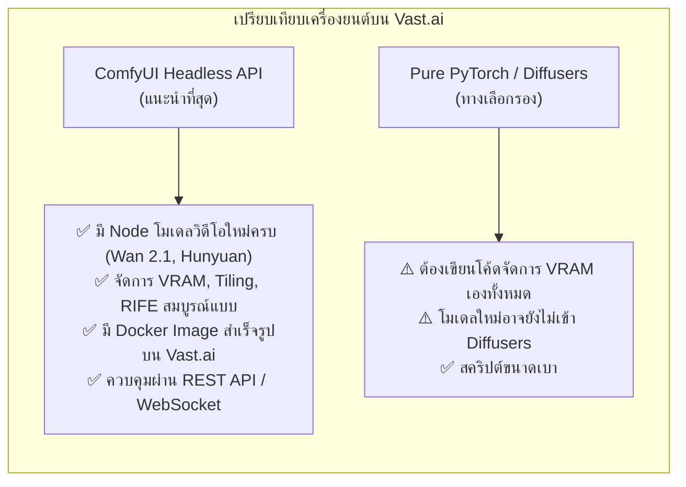
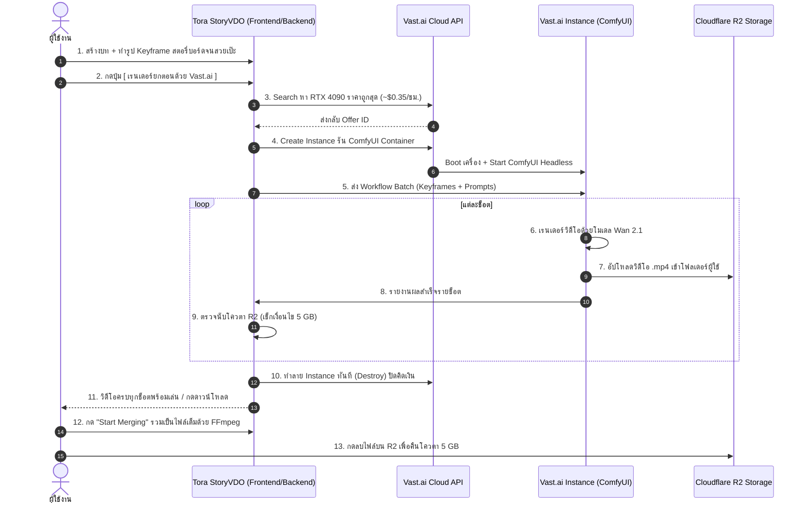

# 🚀 แผนระบบ Vast.ai GPU Rendering + Cloudflare R2 โควตา 5 GB

> **สถาปัตยกรรมระดับโปรดักชันสำหรับ Tora StoryVDO**  
> วิเคราะห์โมเดล (Seedance 2.5 vs Wan 2.1), การเลือกใช้ ComfyUI API, วิธีเรียก Vast.ai REST API และการจัดการพื้นที่ R2 จำกัด 5 GB ต่อคน

---

## 📌 สารบัญ (Table of Contents)
1. [ความจริงเรื่องโมเดล: Seedance 2.5 vs โมเดลบน Vast.ai](#1-ความจริงเรื่องโมเดล-seedance-25-vs-โมเดลบน-vastai)
2. [เลือก Engine ไหนบน Vast.ai: ComfyUI หรือ PyTorch?](#2-เลือก-engine-ไหนบน-vastai-comfyui-หรือ-pytorch)
3. [วิธีเรียก Vast.ai API / CLI อย่างละเอียด](#3-วิธีเรียก-vastai-api--cli-อย่างละเอียด)
4. [สถาปัตยกรรม Cloudflare R2 + ระบบคุมโควตา 5 GB & คิดเงินส่วนเกิน](#4-สถาปัตยกรรม-cloudflare-r2--ระบบคุมโควตา-5-gb--คิดเงินส่วนเกิน)
5. [End-to-End Workflow Diagram](#5-end-to-end-workflow-diagram)

---

## 1. ความจริงเรื่องโมเดล: Seedance 2.5 vs โมเดลบน Vast.ai

จุดนี้เป็นเรื่องที่ผู้ใช้งานหลายคนมักสับสน ซึ่งต้องทำความเข้าใจให้ชัดเจน:

### 🌟 Seedance 2.0 / 2.5 (ByteDance Volcano Engine)
- **ประเภท**: **Closed-source Proprietary Cloud API** (โมเดลแบบปิดของ ByteDance / 豆包)
- **การติดตั้ง**: **ไม่สามารถดาวน์โหลดไฟล์โมเดลมารันเองบน Vast.ai หรือคอมพิวเตอร์ส่วนตัวได้** เพราะ ByteDance ไม่ได้ปล่อย Open Weights
- **การใช้งานในระบบ**: ใน Tora StoryVDO มีตัวเชื่อมต่อ **Volcengine Adapter** (`backend/src/services/adapters/volcengine-video.ts`) อยู่แล้ว สามารถใส่ API Key แล้วสั่งเจน Seedance 2.0 / 2.5 ได้ทันทีผ่านคลาวด์ของ ByteDance

### 🚀 แล้วทำไมคนส่วนใหญ่ถึงใช้ Vast.ai?
คนที่ใช้ Vast.ai ในงานละครสั้น AI จะเช่า GPU เพื่อรัน **โมเดลวิดีโอ Open-source ระดับ SOTA** ที่คุณภาพสูสีกับ Seedance 2.5 แต่**ไม่ต้องเสียค่า API รายครั้ง**:
1. **Alibaba Wan 2.1 (wan2.1-i2v)**: ถือเป็น**ตัวท็อปอันดับ 1 ของโลกในปัจจุบันสำหรับงาน Image-to-Video** เพราะสามารถรับภาพ Keyframe แล้วขยับเป็นวิดีโอโดยใบหน้าและชุดตัวละครไม่เบี้ยวเลย
2. **Tencent HunyuanVideo**: ภาพคมชัดระดับ 1080p มิติแสงเงาแบบภาพยนตร์
3. **CogVideoX / LTX-Video**: เรนเดอร์รวดเร็ว ประหยัด VRAM

> [!IMPORTANT]
> **สรุปแนวทางแนะนำ**:  
> • ถ้าต้องการใช้ **Seedance 2.5**: ให้ใช้ระบบยิงตรงเข้า Volcano Engine / Tora API ที่มีอยู่แล้ว  
> • ถ้าต้องการใช้ **Vast.ai (เช่า RTX 4090)**: แนะนำให้ใช้ **Wan 2.1 (wan2.1-i2v)** ซึ่งจะช่วยประหยัดงบได้ถึง 90% และล็อกหน้าตาตัวละครได้นิ่ง 100%!

---

## 2. เลือก Engine ไหนบน Vast.ai: ComfyUI หรือ PyTorch?

คำตอบที่ฟันธงสำหรับงานวิดีโอในปัจจุบันคือ: **ใช้ ComfyUI (Headless Server with REST API) เป็นอันดับ 1**



### ทำไม ComfyUI ถึงชนะขาดสำหรับ Video Generation?
1. **ComfyUI มี Docker Image สำเร็จรูปบน Vast.ai**:
   - สามารถเลือกรัน Container เช่น `runpod/stable-diffusion:comfy-ui` หรือ `yanwk/comfyui-boot` ได้ในคลิกเดียวโดยไม่ต้องนั่งลง Driver/CUDA เอง
2. **รองรับการสั่งงานแบบ Headless (ไม่เปิดหน้าเว็บ)**:
   - รัน ComfyUI ด้วยคำสั่ง `--listen 0.0.0.0 --port 8188`
   - เซิร์ฟเวอร์ Tora StoryVDO สามารถส่งคำสั่งผ่าน REST API:
     - `POST http://<vast_ip>:8188/prompt` ➜ ส่ง Workflow JSON ที่กำหนดค่าช็อต, ภาพ Keyframe และ Prompt
     - `GET http://<vast_ip>:8188/history/{prompt_id}` ➜ ตรวจสอบสถานะการเรนเดอร์
     - `GET http://<vast_ip>:8188/view?filename=output.mp4` ➜ ดึงไฟล์วิดีโอออกมา

---

## 3. วิธีเรียก Vast.ai API / CLI อย่างละเอียด

Vast.ai มี 2 รูปแบบการสั่งงาน โดยระบบ Tora StoryVDO สามารถเรียกใช้งานได้อัตโนมัติ:

### แบบที่ 1: เรียกผ่าน Vast.ai REST API (แนะนำสำหรับเขียนใน Backend)
* **Base Endpoint**: `https://console.vast.ai/api/v0`
* **Authentication**: ส่ง Header `Authorization: Bearer <VAST_API_KEY>`

#### สเต็ปที่ 1: ค้นหา GPU RTX 4090 ที่ราคาถูกและเน็ตแรง
```typescript
// GET https://console.vast.ai/api/v0/bundles/
const query = {
  gpu_name: { eq: "RTX 4090" },
  num_gpus: { eq: 1 },
  reliability: { gte: 0.98 },
  inet_down: { gte: 200 }
}
const res = await fetch(`https://console.vast.ai/api/v0/bundles/?q=${encodeURIComponent(JSON.stringify(query))}`, {
  headers: { 'Authorization': `Bearer ${VAST_API_KEY}` }
})
const { offers } = await res.json()
const bestOffer = offers[0] // เลือกเครื่องที่ราคาถูกที่สุด
```

#### สเต็ปที่ 2: สั่งสร้าง Instance (เปิดเครื่อง)
```typescript
// PUT https://console.vast.ai/api/v0/asks/{ask_id}/
const createRes = await fetch(`https://console.vast.ai/api/v0/asks/${bestOffer.id}/`, {
  method: 'PUT',
  headers: {
    'Authorization': `Bearer ${VAST_API_KEY}`,
    'Content-Type': 'application/json'
  },
  body: JSON.stringify({
    client_id: 'me',
    image: 'runpod/stable-diffusion:comfy-ui',
    disk: 50, // 50 GB SSD
    onstart: 'bash /workspace/auto_start_comfy.sh'
  })
})
const { new_contract } = await createRes.json()
```

#### สเต็ปที่ 3: ตรวจสอบสถานะเครื่อง & พอร์ตที่เชื่อมต่อ
```typescript
// GET https://console.vast.ai/api/v0/instances/{instance_id}/
const instRes = await fetch(`https://console.vast.ai/api/v0/instances/${instanceId}/`, {
  headers: { 'Authorization': `Bearer ${VAST_API_KEY}` }
})
const instance = await instRes.json()
// เมื่อ instance.actual_status === 'running' ➜ จะได้ IP และ Port ของ ComfyUI
```

#### สเต็ปที่ 4: สั่งลบ/ทำลายเครื่อง (Destroy) ทันทีเมื่อเรนเดอร์จบ
```typescript
// DELETE https://console.vast.ai/api/v0/instances/{instance_id}/
await fetch(`https://console.vast.ai/api/v0/instances/${instanceId}/`, {
  method: 'DELETE',
  headers: { 'Authorization': `Bearer ${VAST_API_KEY}` }
})
// สั่งทำลายเครื่องทันที ➜ หยุดคิดเงิน ไม่เสียค่าเช่าค้างทิ้งไว้
```

---

## 4. สถาปัตยกรรม Cloudflare R2 + ระบบคุมโควตา 5 GB & คิดเงินส่วนเกิน

```mermaid
flowchart TD
    A["Vast.ai GPU Worker\n(เรนเดอร์เสร็จ)"] -->|1. อัปโหลดวิดีโอ .mp4| B["Cloudflare R2 Bucket\n(Path: storyvdo/users/{userId}/...)"]
    B -->|2. Webhook แจ้งขนาดไฟล์ (เช่น 25MB)| C["Tora StoryVDO Backend"]
    C -->|3. อัปเดตตาราง users| D[("users.storage_used_bytes += 25MB")]
    
    D --> E{"เช็กโควตา:\nเกิน 5 GB หรือไม่?"}
    E -- "ไม่เกิน (< 5 GB)" --> F["✅ ให้ดาวน์โหลดฟรีปกติ"]
    E -- "เกิน (> 5 GB)" --> G["⚠️ หักเครดิตส่วนเกินจาก Tora Token\nหรือแจ้งเตือนให้เคลียร์ไฟล์"]
    
    F --> H["ผู้ใช้กดดาวน์โหลดไฟล์ลงเครื่องตัวเอง"]
    H --> I["ผู้ใช้กดปุ่ม 'ลบไฟล์บน Cloud เพื่อคืนพื้นที่'"]
    I -->|ลบไฟล์บน R2| J["users.storage_used_bytes ลดลง\n(โควตา 5 GB หมุนเวียนกลับมาใหม่)"]
```

### 1. โครงสร้างการจัดเก็บไฟล์บน Cloudflare R2
แยกโฟลเดอร์ตาม User ID อย่างเคร่งครัด:
```
vdo (Bucket)/
└── storyvdo/
    └── users/
        └── {user_id}/
            └── videos/
                ├── drama_2_ep_1_shot_01_17300000.mp4
                └── drama_2_ep_1_shot_02_17300020.mp4
```

### 2. การคำนวณและติดตามพื้นที่ (Storage Quota Ledger)
- ในตาราง `users`: เพิ่มฟิลด์ `storage_used_bytes INTEGER DEFAULT 0`
- กำหนดค่าคงที่: `MAX_FREE_STORAGE = 5 * 1024 * 1024 * 1024` (5 GB)
- ทุกครั้งที่มีการอัปโหลดไฟล์วิดีโอใหม่สำเร็จ:
  ```typescript
  // ดึงขนาดไฟล์จาก R2 (HeadObject)
  const fileSize = head.ContentLength || 0;
  // บันทึกขนาดลง assets และเพิ่มใน users
  await db.update(schema.users)
    .set({ storageUsedBytes: sql`${schema.users.storageUsedBytes} + ${fileSize}` })
    .where(eq(schema.users.id, userId));
  ```

### 3. ระบบดาวน์โหลดกลับและการคืนพื้นที่ (Free up Quota)
- **ให้ผู้ใช้ดาวน์โหลดกลับได้**: ในหน้าแอปจะมีปุ่ม **"ดาวน์โหลดเข้าเครื่อง" (Download to Local)**
- **การคืนพื้นที่**: มีปุ่ม **"ลบไฟล์บน Cloud เพื่อคืนโควตา"**
  - เมื่อผู้ใช้ดาวน์โหลดไฟล์ลงเครื่องแล้ว สามารถกดลบไฟล์บน R2 ได้
  - ระบบจะทำการลบออบเจกต์ออกจาก R2 และหักลบ `storage_used_bytes` คืนให้ทันที ทำให้ผู้ใช้มีพื้นที่ 5 GB หมุนเวียนสำหรับโปรเจกต์ต่อไปได้ตลอดเวลา

### 4. กฎการคิดเงินเมื่อเกิน 5 GB (Overage Billing Policy)
หากผู้ใช้ไม่ยอมลบไฟล์ และใช้งานเกิน 5 GB:
- **รูปแบบที่ 1 (หักเครดิตอัตโนมัติ)**: คำนวณส่วนเกิน เช่น เกินมา 2 GB หัก X credits ต่อวันจาก Tora API Token ที่ผู้ใช้เชื่อมต่อไว้
- **รูปแบบที่ 2 (Soft Cap Guard)**: เมื่อแตะ 5 GB ระบบจะอนุญาตให้ดาวน์โหลดไฟล์เดิมได้ปกติ แต่จะระงับการสั่งเรนเดอร์ใหม่ จนกว่าผู้ใช้จะกดลบไฟล์เก่าเพื่อคืนพื้นที่ หรือจ่ายเงินซื้อแพ็กเกจพื้นที่เพิ่ม

---

## 5. End-to-End Workflow Diagram


