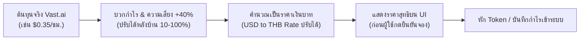
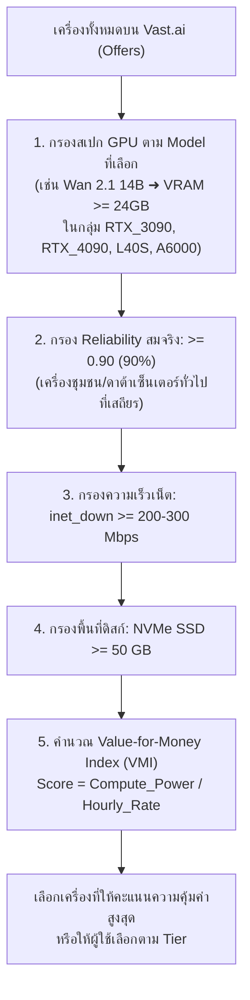
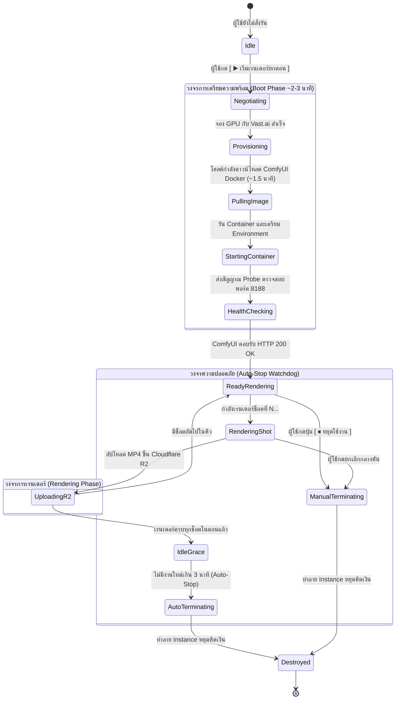
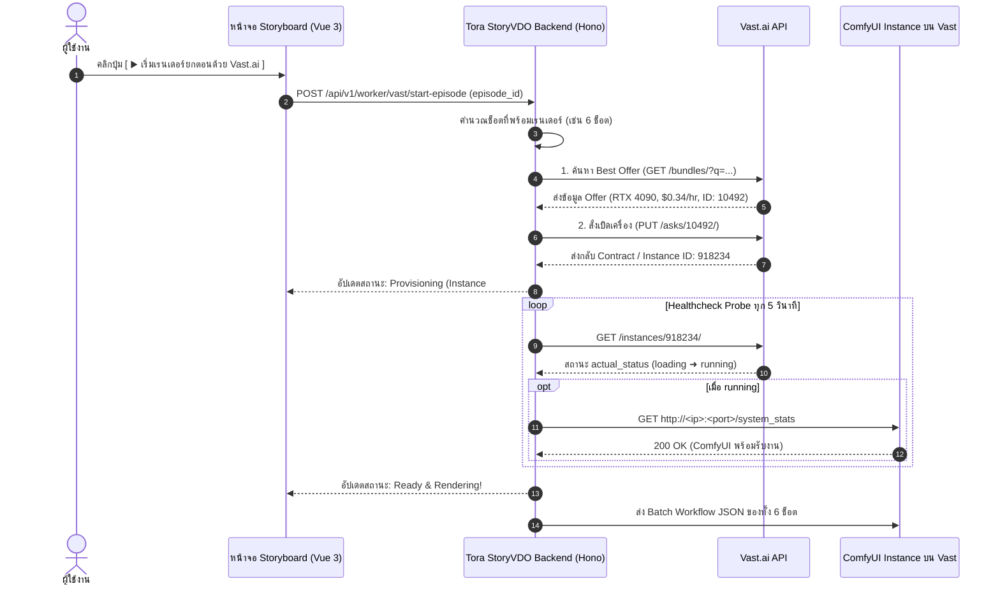
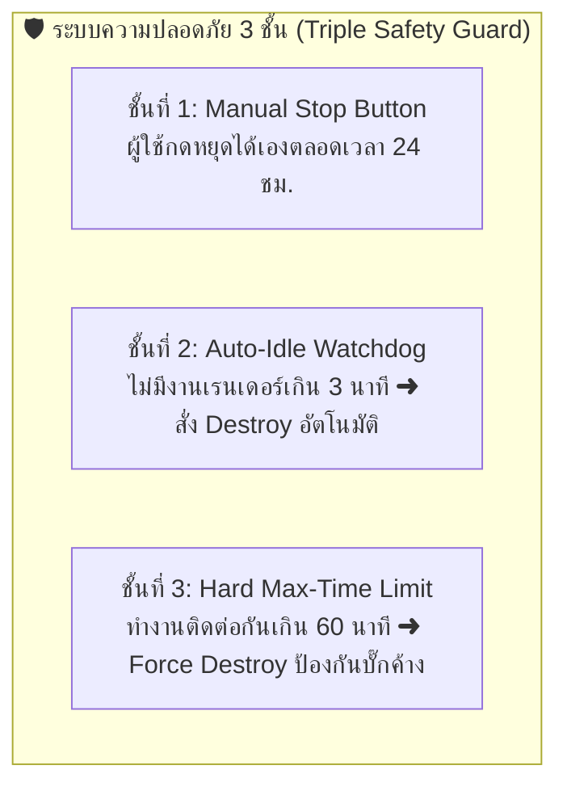

# 🎬 แผนสถาปัตยกรรมละเอียด: ระบบ Vast.ai GPU On-Demand Rendering สำหรับ Tora StoryVDO

> **ครอบคลุมทุกมิติ: การคิดราคา, การคัดเลือก Server, State Machine แสดงความพร้อม, การจอง On-Demand, และระบบ Auto-Stop ป้องกันเงินรั่วไหล**

---

## 📌 สารบัญ (Table of Contents)
1. [โมเดลการคิดราคาและสูตรราคากลาง (Pricing & Billing Model)](#1-โมเดลการคิดราคาและสูตรราคากลาง-pricing--billing-model)
2. [เกณฑ์การคัดเลือกและฟิลเตอร์เซิร์ฟเวอร์บน Vast.ai](#2-เกณฑ์การคัดเลือกและฟิลเตอร์เซิร์ฟเวอร์บน-vastai)
3. [วงจรชีวิตของเซิร์ฟเวอร์ & การแสดงสถานะบน UI (Lifecycle & Readiness States)](#3-วงจรชีวิตของเซิร์ฟเวอร์--การแสดงสถานะบน-ui-lifecycle--readiness-states)
4. [กลไกการจอง On-Demand เมื่อกด Start](#4-กลไกการจอง-on-demand-เมื่อกด-start)
5. [ระบบความปลอดภัย: การกดหยุด (Manual Stop) & การปิดเครื่องอัตโนมัติ (Auto-Stop Watchdog)](#5-ระบบความปลอดภัย-การกดหยุด-manual-stop--การปิดเครื่องอัตโนมัติ-auto-stop-watchdog)
6. [การออกแบบ UI & แดชบอร์ดควบคุม (UI/UX Mockup)](#6-การออกแบบ-ui--แดชบอร์ดควบคุม-uiux-mockup)
7. [สถาปัตยกรรมโค้ดฝั่ง Backend (Vast Service Specification)](#7-สถาปัตยกรรมโค้ดฝั่ง-backend-vast-service-specification)

---

## 1. โมเดลการคิดราคา +40% กำไรและความเสี่ยง พร้อมระบบปรับแต่งหลังบ้าน (Pricing, Margin & Admin Settings)

การให้บริการเช่า GPU เรนเดอร์บน Vast.ai ผู้ให้บริการแพลตฟอร์ม (Tora StoryVDO) จะต้องแบกรับความเสี่ยงหลายด้าน:
1. **ความเสี่ยงของคลาวด์มาร์เก็ตเพลส**: โฮสต์ยกเลิกเครื่องกะทันหัน, ช็อตเรนเดอร์ล้มเหลวต้องรันใหม่
2. **ต้นทุนแฝงของโครงสร้างพื้นฐาน**: แบนด์วิดท์ดาวน์โหลด/อัปโหลด, พื้นที่จัดเก็บ Cloudflare R2, ค่าธรรมเนียม Payment Gateway (PromptPay/Stripe 3-4%)
3. **กำไรของแพลตฟอร์ม (Platform Gross Profit)**

ระบบจึงกำหนด **สูตรบวกมาร์กอัป +40% (Markup & Risk Buffer)** โดยนำต้นทุนเช่า GPU จริงมาคำนวณราคาขาย และ **เปิดให้ผู้ดูแลระบบปรับแต่งตัวเลขเปอร์เซ็นต์กำไรและอัตราแลกเปลี่ยนได้ตลอดเวลาจากระบบหลังบ้าน (Backend Admin Settings)**



### 1.1 ตารางเปรียบเทียบต้นทุนจริง vs ราคาขายบวกกำไร 40%

| ระดับความคุ้มค่า (Tier) | GPU & VRAM | ต้นทุนจริง Vast.ai | ราคาหลังบวกกำไร +40% (USD) | ราคาต่อชั่วโมง (บาท) | ราคาขายต่อช็อต (10s) | ประมาณการกำไรต่อช็อต |
|---|---|---|---|---|---|---|
| **Tier 1: ประหยัดคุ้มค่าที่สุด (Budget King 👑)** | **RTX 3090 / 3090 Ti** (24GB) | ~$0.18 / ชม. | **0.252 USD / ชม.** | **~9.10 บาท / ชม.** | **~1.50 บาท / ช็อต** | **+0.60 บาท / ช็อต (40%)** |
| **Tier 2: สมดุลความเร็วสูงสุด (Sweet Spot ⭐ แนะนำ)** | **RTX 4090** (24GB Ada) | ~$0.35 / ชม. | **0.490 USD / ชม.** | **~17.65 บาท / ชม.** | **~2.50 บาท / ช็อต** | **+1.00 บาท / ช็อต (40%)** |
| **Tier 3: แรมใหญ่ งานหนักลื่นไหล (Heavy Duty 🚀)** | **L40S / RTX 6000 Ada** (48GB) | ~$0.55 / ชม. | **0.770 USD / ชม.** | **~27.70 บาท / ชม.** | **~3.50 บาท / ช็อต** | **+1.40 บาท / ช็อต (40%)** |
| **Tier 4: รุ่นประหยัดโมเดลเบา (Lightweight ⚡)** | **RTX 4080 / 3080** (12-16GB) | ~$0.12 / ชม. | **0.168 USD / ชม.** | **~6.05 บาท / ชม.** | **~0.90 บาท / ช็อต** | **+0.36 บาท / ช็อต (40%)** |

> 📌 *ตัวอย่างคำนวณทั้งตอน (Episode ละ 6 ช็อต = 60 วินาที บน RTX 4090)*:
> * ใช้เวลาเรนเดอร์รวม ~8 นาที = ต้นทุนจริง $0.046 (~1.65 บาท)
> * **ราคาขายรวมบวกกำไร 40% = ~2.32 บาท (คิดต่อช็อต 6 × 2.50 = 15 บาท ตามโมเดล Per-shot)**
> * เจ้าของระบบได้กำไรสุทธิเหนาะๆ ทันที!

---

### 1.2 สถาปัตยกรรมระบบปรับแต่งราคาหลังบ้าน (Admin Dynamic Pricing Config)

ระบบไม่ Hardcode ตัวเลข 40% ลงในโค้ด แต่จัดเก็บลงในตาราง `app_settings` (SQLite) ของระบบหลัก:

#### ตารางค่าคอนฟิกหลังบ้าน (Keys ใน `app_settings`):
1. **`vast_markup_percent`**: เปอร์เซ็นต์มาร์กอัปกำไรและความเสี่ยง (ค่าตั้งต้น: `40`)
2. **`vast_thb_rate`**: อัตราแลกเปลี่ยน USD เป็น THB (ค่าตั้งต้น: `36.00`)
3. **`vast_min_shot_price_thb`**: ราคาขั้นต่ำต่อช็อต (ค่าตั้งต้น: `1.50`)
4. **`vast_r2_overage_price_per_gb_thb`**: ค่าบริการพื้นที่จัดเก็บ R2 ส่วนเกิน 5GB (ค่าตั้งต้น: `5.00` บาท/GB)

#### API Endpoints ฝั่ง Backend:
* `GET /api/v1/settings/vast-pricing`: ดึงค่าคอนฟิกราคาปัจจุบันมาแสดงที่หน้าตั้งค่าผู้ดูแลระบบ และส่งให้หน้าบ้านคำนวณ
* `PUT /api/v1/settings/vast-pricing`: อัปเดตเปอร์เซ็นต์กำไร อัตราแลกเปลี่ยน หรือราคาต่อช็อตได้ทันทีโดยไม่ต้อง Restart Server

```typescript
// backend/src/services/app-settings.ts
export interface VastPricingConfig {
  markupPercent: number      // ค่าเริ่มต้น 40 (%)
  usdToThbRate: number       // ค่าเริ่มต้น 36.0 (THB/USD)
  minShotPriceThb: number    // ค่าเริ่มต้น 1.50 (THB)
  r2OveragePricePerGb: number // ค่าเริ่มต้น 5.00 (THB/GB)
}

export function calculateCustomerPrice(baseVastDph: number, config: VastPricingConfig) {
  // ราคาขายต่อชั่วโมง = ต้นทุนจริง * (1 + 40/100) * อัตราแลกเปลี่ยน
  const customerDphUsd = baseVastDph * (1 + config.markupPercent / 100)
  const customerDphThb = customerDphUsd * config.usdToThbRate
  return {
    baseDphUsd: baseVastDph,
    markupPercent: config.markupPercent,
    customerDphUsd: Number(customerDphUsd.toFixed(3)),
    customerDphThb: Number(customerDphThb.toFixed(2)),
  }
}
```

---

## 2. เกณฑ์การคัดเลือกและฟิลเตอร์เซิร์ฟเวอร์บน Vast.ai (Smart Auto-Filtering)

บน Vast.ai หากตั้งเกณฑ์ความน่าเชื่อถือ `reliability >= 0.98` มักจะ **หาเครื่องไม่ได้เลย** หรือมีเฉพาะเครื่ององค์กรราคาแพงเกินจริง การตั้งเกณฑ์ตามสภาพความเป็นจริงของตลาด (Real-world Market Thresholds) จะใช้ **`reliability >= 0.90`** (หรือ 0.88 - 0.90) ซึ่งมีเครื่องว่างให้เลือกมหาศาลและราคาถูกลงกว่าครึ่ง



### ฟิลเตอร์ Query ที่ส่งเข้า Vast.ai API (รองรับ Multi-GPU Array):
> *หมายเหตุ: ไวยากรณ์ Vast.ai CLI/API ใช้เครื่องหมายขีดล่าง `_` แทนเว้นวรรค เช่น `RTX_3090`, `RTX_4090`, `RTX_6000_Ada`, `L40S`*

```json
{
  "rentable": { "eq": true },
  "reliability": { "gte": 0.90 },
  "num_gpus": { "eq": 1 },
  "gpu_name": {
    "in": ["RTX_3090", "RTX_3090_Ti", "RTX_4090", "L40S", "RTX_6000_Ada", "A6000"]
  },
  "gpu_ram": { "gte": 24000 },
  "inet_down": { "gte": 200 },
  "disk_space": { "gte": 50 },
  "direct_port_count": { "gte": 1 }
}
```

### สูตรคัดเลือกเครื่องอัตโนมัติ (Value-for-Money Optimizer):
ระบบจะคำนวณคะแนนความคุ้มค่าของแต่ละเครื่องที่ผ่านเกณฑ์:
$$\text{Score} = \frac{\text{Relative\_FP8\_TFLOPs}}{\text{dph\_total}}$$
* ตัวอย่าง:
  * **RTX 3090** (TFLOPs ~71, ราคา $0.18/ชม.) ➜ Score = $\frac{71}{0.18} = 394$ *(คุ้มค่าประหยัดสูงสุด!)*
  * **RTX 4090** (TFLOPs ~165, ราคา $0.35/ชม.) ➜ Score = $\frac{165}{0.35} = 471$ *(คุ้มค่าความเร็วสูงสุด!)*
  * ระบบจะแนะนำเครื่องที่มี Score สูงสุดเป็นอันดับแรก

---

## 3. วงจรชีวิตของเซิร์ฟเวอร์ & การแสดงสถานะบน UI (Lifecycle & Readiness States)

ในการเช่า GPU คลาวด์ จะมีช่วงเวลาที่เครื่องกำลังเตรียมความพร้อม (Boot Time) ประมาณ 2-3 นาที ระบบจึงต้องมี **State Machine** เพื่อแสดงให้ผู้ใช้เห็นความคืบหน้าแบบ Real-time โดยไม่ทำให้ผู้ใช้รู้สึกว่าระบบค้าง



### การแสดงผลบน UI ในแต่ละสถานะ (Status Stepper):
1. 🟡 **Negotiating (2-5 วิ)**: `กำลังค้นหาและจับคู่ GPU RTX 4090 ที่ราคาคุ้มค่าที่สุด...`
2. 🟡 **Pulling Image (1-2 นาที)**: `จองเครื่องสำเร็จ (ID: #8921) กำลังดึง Docker Container ComfyUI...`
3. 🟡 **Loading Models (30-45 วิ)**: `ComfyUI เปิดทำงานแล้ว กำลังโหลดโมเดล Wan 2.1 เข้าหน่วยความจำ VRAM...`
4. 🟢 **Rendering (ช็อตละ ~60 วิ)**: `กำลังเรนเดอร์ช็อตที่ 3/6 (ความคืบหน้า 50%) — FPS: 14.2`
5. 🔵 **Completed & Grace Period**: `เรนเดอร์เสร็จสิ้น 6/6 ช็อต! เครื่องจะปิดอัตโนมัติในอีก 02:45 นาทีหากไม่มีงานต่อ`
6. ⚫ **Destroyed**: `ปิดเครื่องและคืนทรัพยากรเรียบร้อยแล้ว (หยุดคิดเงิน)`

---

## 4. กลไกการจอง On-Demand เมื่อกด Start

ระบบจะไม่เปิดเครื่อง GPU ค้างไว้ล่วงหน้า แต่จะทำงานแบบ **On-Demand (กดเมื่อไหร่ จองเมื่อนั้น)**:



---

## 5. ระบบความปลอดภัย: การกดหยุด (Manual Stop) & การปิดเครื่องอัตโนมัติ (Auto-Stop Watchdog)

ความกังวลสูงสุดของผู้ใช้และผู้ดูแลระบบคลาวด์คือ **"ลืมปิดเครื่องจนเงินไหลหมดบัญชี"** ระบบจึงติดตั้งระบบตัดวงจรความปลอดภัย 3 ชั้น (Triple-Guard Circuit Breaker):



### 5.1 ชั้นที่ 1: ปุ่มหยุดใช้งานด้วยตนเอง (Manual Stop)
- บนหน้าจอจะมีปุ่มสีแดงเด่นชัด: **[ ⏹ ยกเลิก & ปิดเซิร์ฟเวอร์ทันที ]**
- เมื่อผู้ใช้กด:
  1. Backend จะสั่งยกเลิกงานที่กำลังเรนเดอร์ในคิว
  2. ส่งคำสั่ง `DELETE https://console.vast.ai/api/v0/instances/{instance_id}/` ทันที
  3. บันทึกยอดค่าใช้จ่ายที่เกิดขึ้นจริงตามเสี้ยววินาที

### 5.2 ชั้นที่ 2: ระบบตรวจจับความว่างงาน (Auto-Idle Watchdog)
- มี Background Cron / Timer วิ่งตรวจจับสถานะทุก 30 วินาที:
  - เช็กว่างานในคิวทั้งหมดเสร็จสิ้นหรือยัง
  - หาก `pending_jobs === 0` และไม่มีงานใหม่เข้ามา:
    - เริ่มนับถอยหลัง **Grace Period (3 นาที)** (เผื่อผู้ใช้ต้องการกด Regenerate ช็อตใดช็อตหนึ่งต่อ)
    - แสดงเวลานับถอยหลังบน UI: `เซิร์ฟเวอร์จะปิดตัวลงเพื่อหยุดคิดเงินในอีก 02:59 นาที...`
    - เมื่อครบ 3 นาที ➜ **เรียกคำสั่ง Destroy ทำลายเครื่องทันที!**

### 5.3 ชั้นที่ 3: ระบบตัดเวลาสูงสุด (Hard Max-Time Cap)
- ป้องกันกรณีโมเดลค้าง เกิด Memory Leak หรือระบบเครือข่ายหลุด
- กำหนดเวลาสูงสุดของ 1 เซสชันไม่เกิน **45 หรือ 60 นาที**
- หากครบเวลา ระบบจะทำการบังคับปิดเครื่อง (Force Terminate) ทันที เพื่อการันตีว่าจะไม่มีการคิดเงินเกินงบที่ผู้ใช้ตั้งไว้แน่นอน

---

## 6. การออกแบบ UI & แดชบอร์ดควบคุม (UI/UX Mockup)

### 6.1 หน้าต่างสั่งเริ่มงานพร้อมแจงราคาบวก 40% (Pre-flight Modal):
```
┌────────────────────────────────────────────────────────────────────────┐
│ 🚀 สั่งเรนเดอร์วิดีโอยกตอนด้วย Vast.ai GPU                            │
├────────────────────────────────────────────────────────────────────────┤
│ • โปรเจกต์: ย้อนเวลาไปเป็นราชายุคสุโขทัย (ตอนที่ 2)                   │
│ • จำนวนช็อตที่พร้อมสร้าง: 6 ช็อต (ความยาวรวม 60 วินาที)                │
│ • โมเดลวิดีโอ: [ Wan 2.1 14B Image-to-Video (รักษาหน้าตาตัวละคร 100%) ▼ ] │
│                                                                        │
│ เลือกระดับความคุ้มค่า GPU (ราคาแสดงรวมค่าบริการระบบ +40% แล้ว):         │
│ ⚪ [ ประหยัดสุด 👑 ] RTX 3090 24GB      — ~1.50 บ./ช็อต (~9 บ./ชม.)     │
│ 🔘 [ แนะนำ ⭐ ]    RTX 4090 24GB      — ~2.50 บ./ช็อต (~18 บ./ชม.)    │
│ ⚪ [ แรมใหญ่ 48G 🚀 ] L40S / 6000 Ada  — ~3.50 บ./ช็อต (~28 บ./ชม.)    │
│                                                                        │
│ จัดเก็บผลลัพธ์: [ Cloudflare R2 (โควตาฟรีคงเหลือ: 4.8 / 5.0 GB) ▼ ]    │
│                                                                        │
│ ┌────────────────────────────────────────────────────────────────────┐ │
│ │ 💰 สรุปประมาณการค่าใช้จ่ายสุทธิ (คำนวณจากตอน 6 ช็อต):               │ │
│ │ • ค่าเช่าเครื่อง GPU พื้นฐาน: ~ 0.050 USD (~1.80 บาท)               │ │
│ │ • ค่าบริการระบบ & ความเสี่ยงแพลตฟอร์ม (+40%): ~ 0.020 USD (~0.72 บ.)│ │
│ │ ───────────────────────────────────────────────────                │ │
│ │ 💎 ยอดรวมประเมินที่หักเครดิต: ~ 2.50 - 3.00 บาท (หรือคิดรายช็อตตามจริง)│ │
│ │ 🛡️ ระบบคิดเงินเฉพาะช็อตที่เรนเดอร์ผ่าน 100% (ล้มเหลวไม่หักเงิน)     │ │
│ │ ⏱️ ระบบจะสั่ง Auto-Stop ทำลายเครื่องทันทีที่เรนเดอร์เสร็จ           │ │
│ └────────────────────────────────────────────────────────────────────┘ │
│                                                                        │
│   [ ยกเลิก ]                        [ ▶ ยืนยันการจอง GPU และเริ่มสร้าง ] │
└────────────────────────────────────────────────────────────────────────┘
```

### 6.2 หน้าจอตั้งค่าราคาหลังบ้านของผู้ดูแลระบบ (Admin Pricing Settings):
```
┌────────────────────────────────────────────────────────────────────────┐
│ ⚙️ ตั้งค่าระบบการคิดราคาและการเรนเดอร์คลาวด์ (Vast.ai Pricing Settings)  │
├────────────────────────────────────────────────────────────────────────┤
│ กำหนดมาร์กอัปกำไรและความเสี่ยง (Profit & Risk Markup):                │
│ [ 40 ] %  (ปรับได้ระหว่าง 0% - 200%, ค่าเริ่มต้น: 40%)                  │
│ *คำอธิบาย: ระบบจะบวกเปอร์เซ็นต์นี้เข้ากับต้นทุนจริงของ Vast.ai อัตโนมัติ │
│                                                                        │
│ อัตราแลกเปลี่ยนเงินตรา (USD to THB Exchange Rate):                     │
│ 1 USD = [ 36.00 ] บาท                                                  │
│                                                                        │
│ ราคาขั้นต่ำต่อช็อต (Minimum Per-Shot Price):                           │
│ [ 1.50 ] บาท / ช็อต 10 วินาที                                          │
│                                                                        │
│ ค่าบริการพื้นที่จัดเก็บ Cloudflare R2 ส่วนเกิน (โควตาฟรี 5 GB):         │
│ [ 5.00 ] บาท / GB / เดือน                                              │
│                                                                        │
│                         [ 💾 บันทึกการตั้งค่าราคาหลังบ้าน ]            │
└────────────────────────────────────────────────────────────────────────┘
```

### 6.3 หน้าจอขณะกำลังทำงาน (Live Execution Console):
```
┌────────────────────────────────────────────────────────────────────────┐
│ ⚡ Vast.ai Live Rendering Engine                                      │
├────────────────────────────────────────────────────────────────────────┤
│ GPU: RTX 4090 (Host #91823)  |  สถานะ: 🟢 กำลังเรนเดอร์ช็อตที่ 4/6     │
│ เวลาทำงาน: 05:22 นาที        |  ค่าใช้จ่ายสะสมปัจจุบัน: 0.031 USD      │
│                                                                        │
│ Progress: [████████████████████░░░░░░░░░░] 66% (4/6 ช็อต)             │
│                                                                        │
│  [✓] ช็อต 1: ทิน นอนบนแคร่ไม้ไผ่ (10s)         ➜ เรนเดอร์สำเร็จ (15 MB)│
│  [✓] ช็อต 2: จัน ถือชามยาเดินเข้ามา (10s)      ➜ เรนเดอร์สำเร็จ (16 MB)│
│  [✓] ช็อต 3: ทิน ชี้กระบอกน้ำ (10s)            ➜ เรนเดอร์สำเร็จ (14 MB)│
│  [⏳] ช็อต 4: จัน ส่งกระบอกน้ำให้ (10s)         ➜ กำลังประมวลผล (Step 18/25)│
│  [⏸] ช็อต 5: ช็อตฝึกพูดภาษาโบราณ (10s)         ➜ รอคิว...              │
│  [⏸] ช็อต 6: เดินออกจากกระท่อม (10s)           ➜ รอคิว...              │
│                                                                        │
│                                    [ ⏹ ยกเลิก & ปิดเซิร์ฟเวอร์ทันที ]  │
└────────────────────────────────────────────────────────────────────────┘
```

---

## 7. สถาปัตยกรรมโค้ดฝั่ง Backend (Vast Service Specification)

โครงสร้างไฟล์และคลาสในระบบ Backend สำหรับควบคุม Vast.ai:

```
backend/src/services/
├── vast-client.ts          # ตัวเชื่อมต่อ API หลักของ Vast.ai (Search, Ask, Instances, Destroy)
├── vast-orchestrator.ts    # ผู้จัดการ State Machine, Watchdog และ Auto-idle Timer
└── comfy-runner.ts         # ตัวแปลงข้อมูลช็อตเป็น ComfyUI Workflow JSON และส่งผ่าน WebSocket
```

### ฟังก์ชันสำคัญใน `backend/src/services/vast-client.ts`:
```typescript
export class VastClient {
  private apiKey: string
  private baseUrl = 'https://console.vast.ai/api/v0'

  constructor(apiKey = process.env.VAST_API_KEY) {
    this.apiKey = apiKey || ''
  }

  // 1. ค้นหา GPU ตามเกณฑ์ความคุ้มค่าและสเปกโมเดล (Performance per Dollar)
  async findBestOffer(options: {
    modelType?: 'wan2.1_14b' | 'wan2.1_1.3b' | 'hunyuan'
    preferredTier?: 'budget' | 'balanced' | 'heavy'
    minReliability?: number
  } = {}): Promise<any> {
    const { modelType = 'wan2.1_14b', preferredTier = 'balanced', minReliability = 0.90 } = options

    // กำหนดกลุ่ม GPU ตามสเปก VRAM ที่โมเดลต้องการ
    let gpuNames = ['RTX_4090']
    let minVram = 24000

    if (preferredTier === 'budget') {
      // เน้นถูกที่สุด: RTX 3090 / 3090 Ti มี 24GB VRAM เท่ากันแต่ค่าเช่าถูกกว่าครึ่ง
      gpuNames = ['RTX_3090', 'RTX_3090_Ti']
    } else if (preferredTier === 'heavy') {
      // เน้น VRAM เหลือๆ ไม่ติดคอขวด: L40S, RTX 6000 Ada (48GB)
      gpuNames = ['L40S', 'RTX_6000_Ada', 'A6000']
      minVram = 48000
    } else {
      // balanced: RTX 4090 สมดุลความเร็วสูงสุด
      gpuNames = ['RTX_4090']
    }

    const query = {
      rentable: { eq: true },
      gpu_name: { in: gpuNames },
      gpu_ram: { gte: minVram },
      num_gpus: { eq: 1 },
      reliability: { gte: minReliability }, // ตลาดจริง 90%+ มีเครื่องเพียบ
      inet_down: { gte: 200 },
      disk_space: { gte: 50 },
    }

    const res = await fetch(`${this.baseUrl}/bundles/?q=${encodeURIComponent(JSON.stringify(query))}`, {
      headers: { Authorization: `Bearer ${this.apiKey}` },
    })
    const data = await res.json()
    if (!data.offers || data.offers.length === 0) {
      throw new Error(`ไม่พบเครื่องในกลุ่ม [${gpuNames.join(', ')}] ที่ reliability >= ${minReliability} ในขณะนี้`)
    }

    // คัดกรองตัวที่คุ้มค่าราคาต่อชั่วโมงที่สุด (Lowest $/hr)
    return data.offers.sort((a: any, b: any) => a.dph_total - b.dph_total)[0]
  }

  // 2. จองและเปิด Instance
  async createInstance(offerId: number, options: { dockerImage: string; onstartCmd: string }): Promise<number> {
    const res = await fetch(`${this.baseUrl}/asks/${offerId}/`, {
      method: 'PUT',
      headers: {
        Authorization: `Bearer ${this.apiKey}`,
        'Content-Type': 'application/json',
      },
      body: JSON.stringify({
        client_id: 'me',
        image: options.dockerImage,
        disk: 50,
        onstart: options.onstartCmd,
      }),
    })
    const data = await res.json()
    if (!data.new_contract) {
      throw new Error(`จองเครื่องไม่สำเร็จ: ${JSON.stringify(data)}`)
    }
    return Number(data.new_contract)
  }

  // 3. ตรวจสอบสถานะและรับ Endpoint
  async getInstance(instanceId: number): Promise<any> {
    const res = await fetch(`${this.baseUrl}/instances/${instanceId}/`, {
      headers: { Authorization: `Bearer ${this.apiKey}` },
    })
    return await res.json()
  }

  // 4. สั่งทำลายเครื่องทันที
  async destroyInstance(instanceId: number): Promise<boolean> {
    const res = await fetch(`${this.baseUrl}/instances/${instanceId}/`, {
      method: 'DELETE',
      headers: { Authorization: `Bearer ${this.apiKey}` },
    })
    const data = await res.json()
    return data.success === true
  }
}
```

---

## 💡 สรุปภาพรวมและจุดแข็งของแผนนี้
1. **แก้ปัญหาความกังวลเรื่องค่าใช้จ่าย**: ผู้ใช้เห็นราคากลางและการประมาณการค่าใช้จ่ายล่วงหน้า (เช่น ~3 บาท/ตอน)
2. **แก้ปัญหาความไม่รู้สถานะ**: มีหน้าจอ Progress Stepper แจ้งชัดเจนว่าเครื่องกำลังโหลด Docker ➜ โหลดโมเดล ➜ เรนเดอร์ช็อตไหนอยู่
3. **ป้องกันเงินรั่วไหล 100%**: ด้วยระบบตัดวงจร 3 ชั้น (Manual Stop + Auto-Idle Watchdog 3 นาที + Hard Limit 60 นาที)
