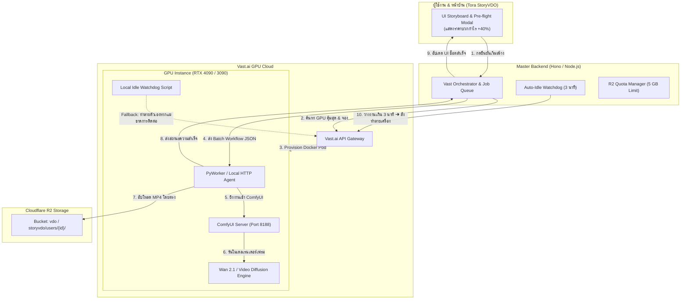

# 🔍 รายงานการวิจัยระบบจองเครื่อง Vast.ai สำหรับงานเรนเดอร์วิดีโอบน GitHub

จากการสืบค้นระบบเปิด (Open-Source Repositories) บน GitHub ที่พัฒนาเพื่อจัดการการเช่าเครื่อง Vast.ai สำหรับงานเรนเดอร์วิดีโอ (ComfyUI Video Generation, Blender Render Farm, Batch Video Inference) พบว่าระบบที่ประสบความสำเร็จในระดับ Production มีรูปแบบสถาปัตยกรรมและการทำงานหลัก 4 เสาหลัก ดังนี้:

---

## 1. โปรเจกต์อ้างอิงสำคัญบน GitHub

### 1.1 `vast-ai/pyworker` (Official Vast.ai Serverless Architecture)
* **GitHub**: [github.com/vast-ai/pyworker](https://github.com/vast-ai/pyworker)
* **สถาปัตยกรรม**:
  * ใช้ **PyWorker** เป็น Reverse Proxy / Agent ขนาดเบาที่เขียนด้วย Python รันอยู่เคียงข้างโปรแกรมเรนเดอร์ (ComfyUI / vLLM / TGI) ภายใน Container เดียวกัน
  * **ComfyUI Integration (`comfyui-json` worker)**:
    * เชื่อมต่อไปยังพอร์ตภายใน `http://127.0.0.1:8188`
    * รับ JSON Request จากภายนอก ➜ แปลงเป็น ComfyUI Prompt Workflow ➜ ยิงเข้า `/prompt`
    * ตรวจจับสถานะความพร้อมผ่าน Log & WebSocket (`/ws`)
    * **Direct Cloud Upload**: เมื่อเรนเดอร์วิดีโอเสร็จ ตัว PyWorker จะอัปโหลดไฟล์ MP4 ขึ้น S3 / Cloudflare R2 ทันที แล้วตอบกลับเป็น Presigned URL / Key
    * **Metrics Reporting**: ส่งค่า Throughput และสถานะ Busy/Idle กลับไปยังระบบ Autoscaler

---

### 1.2 `aipulsedaily/vast-render` (Automated Render Broker)
* **GitHub**: [github.com/aipulsedaily/vast-render](https://github.com/aipulsedaily/vast-render)
* **หน้าที่**: เป็น **Render Broker อัตโนมัติ** สำหรับงาน 3D & Video Rendering
* **โฟลว์วงจรชีวิต (Lifecycle Pipeline)**:
  1. **Fleet Provisioning**: ยิง Vast.ai API ค้นหาเครื่อง GPU ตามสเปก VRAM ที่ต้องการ โดยกรองราคาต่ำสุด
  2. **Scene & Dependency Shipping**: ส่ง assets และ script งานไปยังเครื่องเช่า
  3. **Batch Execution**: สั่งประมวลผลงานตามเฟรม/ช็อต
  4. **Output Verification**: มีฟังก์ชันตรวจสอบความสมบูรณ์ของไฟล์ผลลัพธ์ (ป้องกันไฟล์เสีย/เรนเดอร์ไม่ครบ)
  5. **Auto Fleet Teardown**: เมื่อดึงผลลัพธ์เสร็จสิ้น ระบบจะสั่ง `DELETE /instances/{id}` ทำลายเครื่องทั้งหมดใน Fleet ทันที เพื่อป้องกันค่าใช้จ่ายส่วนเกิน

---

### 1.3 `ai-dock/comfyui` & `vast.ai` Community Provisioning
* **GitHub**: [github.com/ai-dock/comfyui](https://github.com/ai-dock/comfyui)
* **การแก้ปัญหา Cold Boot Time (เวลาเริ่มเครื่องใหม่)**:
  * ในการรันโมเดลวิดีโอขนาดใหญ่ (เช่น Wan 2.1 14B น้ำหนัก ~15-20 GB) การดาวน์โหลดใหม่ทุกครั้งที่เปิดเครื่องจะทำให้เสียเวลา 5-10 นาที
  * ทีมใน GitHub นิยมแก้ปัญหานี้ด้วย 2 แนวทาง:
    1. **Provisioning Script + Aria2 Multi-connection**: ใช้ `aria2c -x 16 -s 16` ดูดน้ำหนักโมเดลจาก Hugging Face Fast Mirror หรือ Cloudflare R2 ทำให้โหลดโมเดล 15GB เสร็จใน 1-2 นาที
    2. **Custom Pre-baked Docker Image**: สร้าง Docker Image ส่วนตัวที่มี ComfyUI + Custom Nodes สำหรับ Wan 2.1 และโมเดล FP8 บิลด์ฝังไว้ใน Image แล้วพุชขึ้น Docker Hub / Private Registry พอดึงอิมเมจเสร็จ เครื่องก็พร้อมเรนเดอร์ได้ทันทีใน 30 วินาที

---

### 1.4 `dolr-ai/prakash-videogen` & Watchdog Self-Termination
* **GitHub**: [github.com/dolr-ai/prakash-videogen](https://github.com/dolr-ai/prakash-videogen)
* **จุดเด่น**:
  * มีระบบ **Daemon Watchdog** รันอยู่ภายในเครื่องเช่า คอยตรวจจับ GPU Utilization และคิวงาน
  * หากไม่มีงานเรนเดอร์ใหม่เกินเวลาที่กำหนด (Idle Timeout เช่น 3-5 นาที) ตัว Daemon จะส่ง webhook แจ้ง Main Orchestrator หรือใช้ Vast API Key สั่ง Self-Destroy ทำลายตัวเองทันที (Safety Net แม้ Master Server จะหลุดการเชื่อมต่อ)

---

## 2. แผนผังเปรียบเทียบสถาปัตยกรรม (Architecture Comparison)

---

## 3. สรุปบทเรียนที่นำมาปรับใช้กับ Tora StoryVDO

1. **เลือกใช้รูปแบบ PyWorker + ComfyUI REST API**:
   * การส่งงานแบบ JSON Workflow ผ่าน REST/WebSocket เข้า ComfyUI เป็นวิธีที่ยืดหยุ่นที่สุดสำหรับโมเดล Wan 2.1 เพราะสามารถใส่ LoRA, ปรับ VAE Tiling, และควบคุม Resolution ได้จากฝั่ง Backend
2. **ระบบ Direct-to-R2 Upload บน Worker**:
   * ไม่ต้องดึงไฟล์วิดีโอกลับมาผ่าน Backend ให้เปลืองแบนด์วิดท์เซิร์ฟเวอร์หลัก แต่ให้ Instance บน Vast.ai สตรีมไฟล์ MP4 ขึ้น Cloudflare R2 โดยตรงด้วย Presigned PUT URL
3. **ระบบตัดวงจร 2 ทาง (Dual Watchdog Circuit Breaker)**:
   * **ทางที่ 1 (Master Watchdog)**: ฝั่ง Backend คอยตรวจเช็คงานในคิว ถ้าหมดงานเกิน 3 นาที สั่ง `DELETE /instances/{id}`
   * **ทางที่ 2 (Host Self-Kill Script)**: ใส่สคริปต์ตรวจจับบนเครื่อง Vast.ai ถ้าไม่มี Request เข้าพอร์ต 8188 นานเกิน 5 นาที ให้สั่งคำสั่ง `vastai destroy instance $CONTAINER_ID` เพื่อเป็นตัวคุมความเสี่ยงชั้นสุดท้าย
4. **การคำนวณราคาบวกกำไร +40% พร้อมระบบปรับแต่งหลังบ้าน**:
   * นำตัวเลขต้นทุนจริงจาก Vast.ai API มาเข้าสูตรบวกกำไร 40% และให้ผู้ใช้เห็นราคาที่แน่นอนก่อนกดเริ่มงาน
