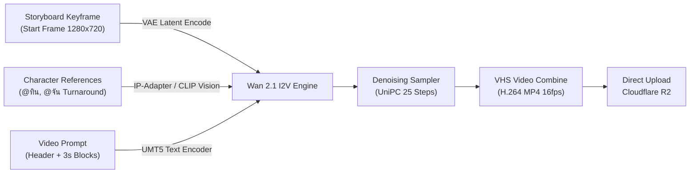

# สถาปัตยกรรมระบบเรนเดอร์วิดีโอคลาวด์ Vast.ai สำหรับ Tora StoryVDO
## คู่มือวิเคราะห์เชิงลึก: Vast API Search, 15 GPU TFLOPS Catalogue, $20 Reserve, Multi-Scene Queue, Reference Fidelity & Wan 2.1 Template Orchestration

---

## 1. การทำงานและค้นหาเครื่องผ่าน Vast.ai API (Search & TFLOPS/Hr)

ระบบของ Vast.ai เป็น **Decentralized GPU Marketplace** ที่ผู้ให้เช่าเครื่อง (Host) นำเครื่องคอมพิวเตอร์และเซิร์ฟเวอร์มาตั้งราคาประมูลแบบ Real-time โดย Vast มี Search Engine ภายในที่สามารถค้นหาผ่าน REST API หรือ CLI ได้อย่างแม่นยำ

### 1.1 โครงสร้าง Endpoint และพารามิเตอร์การค้นหา
- **Endpoint**: `GET https://console.vast.ai/api/v0/bundles/?q={JSON_QUERY}`
- **Header**: `Authorization: Bearer <VAST_API_KEY>`

```json
{
  "rentable": { "eq": true },
  "reliability": { "gte": 0.90 },
  "num_gpus": { "eq": 1 },
  "gpu_name": { "in": ["RTX_4090", "RTX_3090", "L40S"] },
  "disk_space": { "gte": 50 },
  "inet_down": { "gte": 200 },
  "order": [["flops_per_dphtotal", "desc"]]
}
```

### 1.2 ตัวชี้วัดสำคัญในการเลือกเครื่อง
1. **`total_flops`**: กำลังประมวลผลคำนวณทางคณิตศาสตร์ FP32 ดิบ (TFLOPS) ยิ่งสูงโมเดลยิ่งรัน Denoising Sampler ได้เร็ว
2. **`flops_per_dphtotal` (TFLOPS per Dollar per Hour)**: ดัชนีวัด **ความคุ้มค่าสูงสุดต่อเม็ดเงิน** คำนวณจาก `total_flops / dph_total` ซึ่งทำให้ระบบสามารถจับคู่เครื่องที่เร็วและราคาถูกที่สุดให้ลูกค้าได้โดยอัตโนมัติ
3. **`reliability`**: ดัชนีความเสถียรของโฮสต์ (ตั้งเกณฑ์ไว้ที่ $\ge 0.90$ ตามความเหมาะสมของตลาด Vast.ai)
4. **`inet_down` / `inet_up`**: แบนด์วิดท์ดาวน์โหลดและอัปโหลด ต้องไม่ต่ำกว่า 200-350 Mbps เพื่อให้ดาวน์โหลด Weights โมเดล Wan 2.1 (ขนาด ~20 GB) ได้ในเวลาไม่เกิน 90-120 วินาที

---

## 2. แคตตาล็อก GPU 15 รุ่น ครอบคลุม 4 ระดับ (Tier) พร้อมราคากลาง (+40% Markup)

เนื่องจากการพึ่งพาเพียง 3 รุ่นไม่ตอบโจทย์ความยืดหยุ่น ระบบ **Tora StoryVDO** ได้ขยายแคตตาล็อก GPU ครบทั้ง 15 รุ่น พร้อมกำหนดราคากลาง (Median Rate Cards) และคำนวณกำไรบวกความเสี่ยง **+40%** ที่ปรับแก้ได้จากระบบหลังบ้าน:

| GPU Model | VRAM | TFLOPS (FP32) | TFLOPS/Hr (ความคุ้มค่า) | ราคากลาง ($/ชม.) | ราคาขายลูกค้า (+40%) | คิดเป็นเงินบาท/ชม. | ประมาณการ/ช็อต | เหมาะสำหรับงาน |
| :--- | :---: | :---: | :---: | :---: | :---: | :---: | :---: | :--- |
| **Tier 24GB (Sweet spot แนะนำสำหรับ Wan 2.1 14B)** | | | | | | | | |
| **RTX 3090** | 24 GB | 35.6 | 197.8 | $0.180 | $0.252 | ~9.20 บาท | ~1.50 บาท | ประหยัดที่สุด VRAM 24GB คุ้มค่าสูงสุด |
| **RTX 3090 Ti** | 24 GB | 40.0 | 200.0 | $0.200 | $0.280 | ~10.22 บาท | ~1.50 บาท | แบนด์วิดท์สูงขึ้น เรนเดอร์ไวกว่า 3090 ราว 15% |
| **RTX 4090 (Ada)** ⭐ | 24 GB | 82.6 | 236.0 | $0.350 | $0.490 | ~17.88 บาท | ~1.50 บาท | **แนะนำสูงสุด** สถาปัตยกรรม Ada เร็วสุดในกลุ่ม 24GB |
| **RTX 4090 D** | 24 GB | 73.5 | 222.7 | $0.330 | $0.462 | ~16.86 บาท | ~1.50 บาท | สเปกใกล้เคียง 4090 ราคาประหยัดลง |
| **RTX A5000** | 24 GB | 27.8 | 126.4 | $0.220 | $0.308 | ~11.24 บาท | ~1.50 บาท | เวิร์กสเตชัน เสถียรสูง รันงานต่อเนื่อง |
| **Tier 48GB (Heavy Duty / รันยาวแบบไร้คอขวด VRAM Swap)** | | | | | | | | |
| **L40S (Ada)** ⭐ | 48 GB | 91.6 | 157.9 | $0.580 | $0.812 | ~29.64 บาท | ~1.50 บาท | **แนะนำสำหรับงานหนัก** มี FP8 Engine แรม 48GB |
| **L40 (Ada)** | 48 GB | 90.5 | 188.5 | $0.480 | $0.672 | ~24.53 บาท | ~1.50 บาท | ใกล้เคียง L40S แต่ราคาประหยัดกว่า |
| **RTX 6000 Ada** | 48 GB | 91.1 | 140.2 | $0.650 | $0.910 | ~33.21 บาท | ~1.50 บาท | ชิปเต็มประสิทธิภาพระดับภาพยนตร์ |
| **RTX A6000 (Ampere)** | 48 GB | 38.7 | 86.0 | $0.450 | $0.630 | ~23.00 บาท | ~1.50 บาท | รุ่นก่อนหน้า แรม 48GB ในราคาย่อมเยา |
| **Tier 80GB (Studio High-Speed / ข้อมูลแบนด์วิดท์ 2TB/s)** | | | | | | | | |
| **A100 SXM4 (80GB)** | 80 GB | 19.5 | 17.7 | $1.100 | $1.540 | ~56.21 บาท | ~1.50 บาท | แรม HBM2e กว้างขวาง รันหลายช็อตขนานได้ |
| **A100 PCIe (80GB)** | 80 GB | 19.5 | 20.5 | $0.950 | $1.330 | ~48.54 บาท | ~1.50 บาท | รุ่นบัส PCIe ประหยัดกว่า SXM |
| **H100 SXM (80GB)** | 80 GB | 67.0 | 30.5 | $2.200 | $3.080 | ~112.42 บาท | ~2.03 บาท | สถาปัตยกรรม Hopper ทรงพลังที่สุด |
| **Tier 16GB (พรีวิวเร็ว / โมเดลตัวเบา เช่น Wan 2.1 1.3B / LTX-Video)** | | | | | | | | |
| **RTX 4080** | 16 GB | 48.7 | 270.6 | $0.180 | $0.252 | ~9.20 บาท | ~1.50 บาท | คุ้มค่ามากสำหรับโมเดลขนาดเล็ก |
| **RTX 4070 Ti Super** | 16 GB | 44.1 | 294.0 | $0.150 | $0.210 | ~7.67 บาท | ~1.50 บาท | คุ้มค่าเงินที่สุดในระดับมิดเรนจ์ |
| **RTX A4000** | 16 GB | 19.2 | 160.0 | $0.120 | $0.168 | ~6.13 บาท | ~1.50 บาท | ประหยัดพลังงาน ราคาถูกมาก |

---

## 3. กฎเหล็กเงินสำรอง $20 (Pre-flight $20 Reserve Guarantee)

### ทำไมต้องสำรองเงินอย่างน้อย $20.00 ใน Vast.ai?
1. **นโยบายตัดการเชื่อมต่อของโฮสต์ (Host Preemption)**: ใน Vast.ai หากเครดิตในบัญชีลดลงใกล้ศูนย์ โฮสต์บนคลาวด์จะส่งคำสั่งทำลายคอนเทนเนอร์ (`docker rm -f`) ทันที ทำให้วิดีโอที่กำลังเรนเดอร์ค้างอยู่เสียหายทั้งหมด
2. **ความคุ้มครองความเสี่ยง (Overhead Buffer)**: ในระหว่างบูตเครื่อง (Provisioning 2-3 นาที) จะมีค่าใช้จ่ายเกิดขึ้น หากเครดิตไม่พอจะส่งผลให้เปิดเครื่องไม่สำเร็จ
3. **การทำงานของระบบใน Tora StoryVDO**:
   - ตรวจสอบยอดผ่าน `GET /api/v0/users/current/` (อ่านฟิลด์ `credit`)
   - หาก `credit < 20.00` ระบบจะขึ้นแถบแจ้งเตือนสีส้ม แสดงยอดคงเหลือจริงและยอดที่ขาด พร้อมบล็อกปุ่มกดยืนยันจองทันที

---

## 4. การเลือกช็อตข้ามตอนแบบยืดหยุ่น (Multi-Episode & Multi-Scene Batch)

### ตัวอย่างการใช้งานจริง
- **ตอนที่ 1**: เลือก 6 scene
- **ตอนที่ 2**: เลือก 8 scene
- **รวมคิวในรอบเดียว**: 14 scene (เวลารวมประมาณ 140 วินาทีวิดีโอ)

### ข้อได้เปรียบทางเศรษฐศาสตร์ (Cost Economics)
1. **ลดภาระ Cold Boot**: การเปิดเครื่อง GPU และโหลดโมเดล Wan 2.1 ขนาด 20 GB เข้า VRAM ใช้เวลาคงที่ประมาณ **3-4 นาที** (คิดเป็นเงินประมาณ ~0.80 - 1.20 บาท)
2. **กระจายต้นทุน**: หากเรนเดอร์ทีละตอน ช็อตละจะแบกรับค่าบูตเครื่องสูง แต่เมื่อรวม 14 ช็อตในคิวเดียว ต้นทุนค่าบูตเฉลี่ยเหลือเพียง **0.07 บาทต่อช็อต**!
3. **การจัดการใน UI**: มี Episode Tabs ให้คลิกสลับตอน ติ๊กเลือกช็อตข้ามไปมาได้อย่างอิสระ พร้อมระบบคำนวณเวลารวมและราคารวมแบบสด (Real-time)

---

## 5. ความสมบูรณ์ของภาพอ้างอิง (Reference Fidelity Pipeline)

เพื่อให้วิดีโอที่สร้างออกมาตรงกับเนื้อเรื่องและตัวละครไม่เพี้ยน ระบบส่ง Reference 3 ชั้นเข้าสู่โมเดล Wan 2.1:



1. **Start Frame (ภาพ Keyframe เริ่มต้น)**:
   - ดึงจาก `storyboards.first_frame_image` หรือ `storyboards.composed_image`
   - ส่งเข้า Node `LoadImage` $\rightarrow$ `WanVideoVAELoader` เพื่อกำหนดตำแหน่ง ยืนยันเสื้อผ้า หน้าตา และโครงสร้างของฉาก ณ วินาทีที่ 0
2. **Character Reference Sheets**:
   - ดึงภาพใบหน้าและชุดของตัวละครหลัก (`characters.imageUrl`)
   - ส่งเข้าตัวถอดรหัส CLIP Vision (`clip_vision_h.safetensors`) เพื่อล็อกอัตลักษณ์ของใบหน้าตลอดการเคลื่อนไหว
3. **การคัดกรอง Static Profile ทิ้ง**:
   - ใน `video-prompts.ts` ระบบมีอัลกอริทึมตัดข้อความลักษณะภายนอกเริ่มต้น (appearance, styling) ออกจาก Header Prompt หากตัวละครมีรูป Reference แล้ว เพื่อป้องกันไม่ให้คำบรรยายเก่าไปขัดแย้งกับสภาพจริงในฉากใหม่ (เช่น ฉากบาดเจ็บ เสื้อผ้าขาด หรือเปลี่ยนชุด)

---

## 6. การแปลงระยะเวลา (วินาที) เป็นจำนวนเฟรมโมเดล (Frame Count)

Wan 2.1 Image-to-Video ถูกเทรนมาที่ความเร็วมาตรฐาน **16 FPS (Frames Per Second)**:

$$\text{Total Frames} = \text{Math.round}(\text{Duration In Seconds} \times 16) + 1$$

*(หมายเหตุ: บวก 1 เฟรมเสมอสำหรับ Initial Keyframe Conditioning)*

| ความยาววิดีโอ (วินาที) | จำนวนเฟรมที่ส่งเข้าโมเดล | เวลาประมวลผลบน RTX 4090 | ขนาดไฟล์โดยประมาณ (H.264 720p) |
| :---: | :---: | :---: | :---: |
| **3 วินาที** | 49 เฟรม | ~18 วินาที | ~4.5 MB |
| **5 วินาที** | 81 เฟรม | ~30 วินาที | ~7.5 MB |
| **8 วินาที** | 129 เฟรม | ~48 วินาที | ~12.0 MB |
| **10 วินาที** | 161 เฟรม | ~60 วินาที | ~15.0 MB |

ในหน้าต่าง Inspector ของระบบ ผู้ใช้สามารถปรับเปลี่ยนตัวเลขวินาทีได้โดยตรง และระบบจะคำนวณจำนวนเฟรมที่ส่งให้ ComfyUI / PyTorch ให้เห็นแบบสดๆ

---

## 7. โครงสร้างและความครบถ้วนของ Video Prompt

Video Prompt สำหรับ Wan 2.1 ในระบบ Tora StoryVDO ถูกออกแบบเป็นโครงสร้าง 4 ส่วน:

```
[สไตล์ภาพ: ซีรีส์พีเรียดไทย แสงภาพยนตร์ 8K]
ตัวละคร: @ทิน, @จัน; ฉาก: @ภายในกระท่อมของจัน (แสงอรุณรุ่งสีทองอ่อนลอดผ่านร่องฝาไม้ไผ่ ละอองฝุ่นลอยนวลตา เงียบสงบ).
0-3s: @ภายในกระท่อมของจัน, ภาพระยะปานกลาง, กล้องนิ่ง; @ทิน นอนแน่นิ่งอยู่บนแคร่ไม้ไผ่ ลำตัวและขาพันด้วยเศษผ้าเปื้อนคราบสมุนไพรพอกหนา ใบหน้าซีดเซียวเหงื่อซึม ค่อยๆ กะพริบตาและลืมตาขึ้นอย่างอ่อนแรง
3-6s: ตัดสลับไปที่โคลสอัพ, กล้องเคลื่อนเข้าช้าๆ; @จัน นั่งลงข้างแคร่ไม้ไผ่ มือประคองชามดินเผาใส่ยาต้มควันกรุ่น ตักยาด้วยช้อนไม้ค่อยๆ ยื่นจ่อริมฝีปากเขาด้วยสีหน้าห่วงใยระมัดระวัง; จันพูดว่า: "กินยานี่เสีย ไข้จะได้สร่าง อย่าเพิ่งขยับตัวแรง"
6-10s: ตัดสลับไปที่โคลสอัพ, กล้องนิ่ง; @ทิน ขยับริมฝีปากแห้งผากอย่างยากลำบาก สายตาสับสนพึมพำแผ่วเบา; ทินพูดว่า: "น้ำ... ที่นี่... โรงพยาบาล... หรือ?"; @จัน ชะงักช้อนยาค้างเติ่ง สบตาเขาด้วยสีหน้าสงสัยไม่เข้าใจในถ้อยคำแปลกประหลาด
```

- **Header**: ระบุตัวละครที่เข้าฉากและสภาพแวดล้อม
- **Time-sliced Blocks (แบ่งช่วงละ 3 วินาที)**: ระบุการกระทำของตัวละคร, มุมกล้อง (Camera movement), และบทสนทนา
- **Negative Prompt**:
  `blurry, low quality, distorted anatomy, morphing hands, extra limbs, cartoon, anime, text, watermark, jittery motion, flickering lighting`

---

## 8. การทำงานของ Vast.ai Template และการเรนเดอร์จริง

ระบบ Vast.ai ใช้กลไก **Docker Container** ในการรัน โดยมี 2 รูปแบบหลัก:

### รูปแบบที่ 1: ComfyUI Headless / Serverless Template (แนะนำ)
- **Base Image**: `ghcr.io/ai-dock/comfyui:latest-cuda` หรือ `pytorch/pytorch:2.5.1-cuda12.4-cudnn9-runtime`
- **การติดตั้ง Provisioning Script ใน `onstart`**:
  ```bash
  #!/usr/bin/env bash
  # โหลดโมเดลผ่าน aria2c มัลติคอนเนกชัน 16 เธรด จาก R2 Fast Mirror (~90 วินาที)
  mkdir -p /opt/ComfyUI/models/diffusion_models /opt/ComfyUI/models/text_encoders /opt/ComfyUI/models/vae
  aria2c -x 16 -s 16 -k 1M -c -d /opt/ComfyUI/models/diffusion_models "https://r2-mirror.torastoryvdo.com/wan2.1_i2v_720p_14B_fp8.safetensors"
  aria2c -x 16 -s 16 -k 1M -c -d /opt/ComfyUI/models/text_encoders "https://r2-mirror.torastoryvdo.com/umt5_xxl_fp8_e4m3fn_scaled.safetensors"
  aria2c -x 16 -s 16 -k 1M -c -d /opt/ComfyUI/models/vae "https://r2-mirror.torastoryvdo.com/wan2.1_vae.safetensors"
  
  # สตาร์ต ComfyUI
  python main.py --listen 0.0.0.0 --port 8188 --highvram --fast
  ```
- **การส่งงานผ่าน REST API**:
  Tora StoryVDO ส่ง JSON Workflow เข้า `POST http://<vast_host>:<port>/prompt` พร้อมติดตามสถานะแบบเรียลไทม์ผ่าน WebSocket (`/ws?clientId=...`)
- **การส่งไฟล์ขึ้น Cloudflare R2**:
  เมื่อเรนเดอร์จบ ช็อตจะถูกส่งตรงเข้า Cloudflare R2 ผ่าน S3-compatible API เพื่อไม่ให้กินเนื้อที่บนเครื่อง GPU
- **การตัดวงจรอัตโนมัติ (Auto-Stop Watchdog)**:
  เมื่อเรนเดอร์ครบทุกช็อต ตัวนับถอยหลัง 3 นาทีจะเริ่มทำงาน หากไม่มีงานใหม่เข้ามา Backend จะส่งคำสั่ง `DELETE /api/v0/instances/{id}/` ทันทีเพื่อหยุดคิดเงินโฮสต์!
