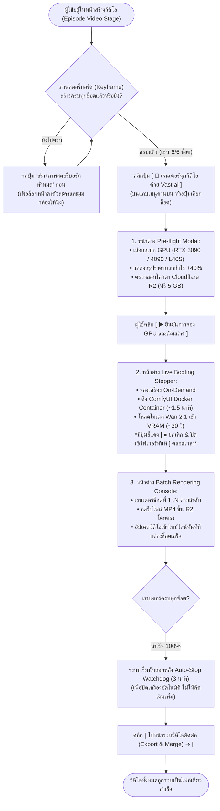

# 🎨 การออกแบบ UI และ User Flow: ระบบเรนเดอร์ทุกวิดีโอด้วย Vast.ai GPU

> **สำหรับ: Tora StoryVDO (หน้าจอ Episode Storyboard & Video Workbench)**  
> **แนวคิดหลัก**: ไร้รอยต่อ (Seamless), โปร่งใสเรื่องราคา (+40% Markup), เห็นความคืบหน้าแบบ Real-time, และปลอดภัยด้วยปุ่มหยุดฉุกเฉินและ Auto-Stop Watchdog

---

## 📌 สารบัญ
1. [แผนภาพ User Flow ภาพรวมทั้งระบบ (End-to-End Flowchart)](#1-แผนภาพ-user-flow-ภาพรวมทั้งระบบ-end-to-end-flowchart)
2. [เปรียบเทียบหน้าตา UI ของเดิม vs ของใหม่ (Before vs After)](#2-เปรียบเทียบหน้าตา-ui-ของเดิม-vs-ของใหม่-before-vs-after)
3. [รายละเอียด 3 หน้าจอหลักของ Vast.ai Batch Render Modal](#3-รายละเอียด-3-หน้าจอหลักของ-vastai-batch-render-modal)
4. [จุดเชื่อมต่อเมนูในหน้าจอสตอรี่บอร์ด (Placement & Touchpoints)](#4-จุดเชื่อมต่อเมนูในหน้าจอสตอรี่บอร์ด-placement--touchpoints)
5. [ข้อมูลทางเทคนิคและการส่งผ่าน State (Component & State Architecture)](#5-ข้อมูลทางเทคนิคและการส่งผ่าน-state-component--state-architecture)

---

## 1. แผนภาพ User Flow ภาพรวมทั้งระบบ (End-to-End Flowchart)



---

## 2. เปรียบเทียบหน้าตา UI ของเดิม vs ของใหม่ (Before vs After)

### 2.1 แถบเครื่องมือด้านบน (Production Toolbar)

#### ❌ ของเดิม (Before):
มีเฉพาะปุ่มสร้างทีละระบบ ไม่มีปุ่มส่งไป GPU คลาวด์ภายนอกแบบยกตอน:
```
[ สร้างสตอรี่บอร์ดใหม่ ] [ สกัดพรอมต์วิดีโอ ] [ สร้างภาพสตอรี่บอร์ดทั้งหมด ] [ เลือกช็อต ] [ สร้างวิดีโอ ]
```

#### ✅ ของใหม่ (After):
เพิ่มปุ่ม **Gradient โดดเด่น** ที่มองเห็นง่าย พร้อมแสดง Badge จำนวนช็อตที่พร้อมเรนเดอร์:
```
[ สร้างสตอรี่บอร์ดใหม่ ] [ สกัดพรอมต์ ] [ สร้างภาพสตอรี่บอร์ด (6/6) ] | [ 🚀 เรนเดอร์ทุกวิดีโอด้วย Vast.ai (6 ช็อต) ] [ สร้างวิดีโอทีละช็อต ▼ ]
```
> 🌟 **จุดเด่น**: ปุ่ม Vast.ai ใช้สีม่วง-ชมพู Gradient (`#8b5cf6` ➜ `#ec4899`) มีไอคอน Sparkles ดึงดูดสายตา และคลิกเดียวสามารถส่งเรนเดอร์ทั้ง 6 ช็อตพร้อมกันได้ทันที

---

### 2.2 ในแถวของแต่ละช็อต (Storyboard Card / Video Task Row)

#### ❌ ของเดิม (Before):
มีเฉพาะปุ่ม `Colab / Kaggle` หรือปุ่มสร้างทั่วไป

#### ✅ ของใหม่ (After):
มีปุ่มตัวเลือกและ Badge ชัดเจน:
* ช็อตที่มีภาพสตอรี่บอร์ดพร้อม: แสดงปุ่ม **`[ ⚡ Vast GPU ]`** (สามารถกดเรนเดอร์เฉพาะช็อตนี้ได้)
* เมื่อเรนเดอร์ผ่าน Vast.ai เสร็จ: มีแท็ก **`[ 🟢 Wan 2.1 (Vast.ai) ]`** กำกับไว้ที่มุมขวาบนของวิดีโอ

---

## 3. รายละเอียด 3 หน้าจอหลักของ Vast.ai Batch Render Modal

หน้าต่าง Modal จะแบ่งเป็น 3 สเต็ปอย่างชัดเจน เพื่อให้ผู้ใช้รู้สึกมั่นใจและควบคุมได้ทุกขั้นตอน:

### 3.1 ขั้นตอนที่ 1: หน้าต่างสรุปก่อนเริ่ม (Pre-flight & Pricing Configuration)

```
┌────────────────────────────────────────────────────────────────────────────────────────┐
│ 🚀 เรนเดอร์วิดีโอยกตอนด้วย Vast.ai GPU Cloud                                           [✕] │
├────────────────────────────────────────────────────────────────────────────────────────┤
│ • เรื่อง: ย้อนเวลาไปเป็นราชายุคสุโขทัย (ตอนที่ 2)  |  ความยาวรวม: 6 ช็อต (60 วินาที)        │
│ • ภาพสตอรี่บอร์ดต้นฉบับ: [ ✓ พร้อมแล้ว 6/6 ช็อต (ล็อกหน้าตาตัวละคร 100%) ]              │
│ • โมเดล AI วิดีโอ: [ Wan 2.1 14B Image-to-Video (ภาพยนตร์ความละเอียดสูง 720p) ▼ ]       │
│                                                                                        │
│ 1. เลือกระดับความคุ้มค่าของ GPU (จับคู่ VRAM >= 24GB):                                  │
│ ┌────────────────────────────────────────────────────────────────────────────────────┐ │
│ │ ⚪ [ ประหยัดคุ้มค่า 👑 ] NVIDIA RTX 3090 (24GB)                                    │ │
│ │    • ค่าบริการ: ~1.50 บาท / ช็อต (~9 บาท/ชม.)  |  ความเร็ว: ~90-120s ต่อช็อต       │ │
│ ├────────────────────────────────────────────────────────────────────────────────────┤ │
│ │ 🔘 [ สมดุลแนะนำ ⭐ ] NVIDIA RTX 4090 (24GB Ada)                                   │ │
│ │    • ค่าบริการ: ~2.50 บาท / ช็อต (~18 บาท/ชม.) |  ความเร็ว: ~50-70s ต่อช็อต (เร็วกว่า 2x)│ │
│ ├────────────────────────────────────────────────────────────────────────────────────┤ │
│ │ ⚪ [ แรมใหญ่ 48G 🚀 ] NVIDIA L40S / RTX 6000 Ada (48GB)                             │ │
│ │    • ค่าบริการ: ~3.50 บาท / ช็อต (~28 บาท/ชม.) |  ความเร็ว: ~40-60s ต่อช็อต         │ │
│ └────────────────────────────────────────────────────────────────────────────────────┘ │
│                                                                                        │
│ 2. พื้นที่จัดเก็บบน Cloudflare R2:                                                      │
│    โควตาฟรี: [██████░░░░░░░░░░░░░░░░] 0.8 GB / 5.0 GB (เหลือพื้นที่ว่าง 4.2 GB)        │
│                                                                                        │
│ ┌────────────────────────────────────────────────────────────────────────────────────┐ │
│ │ 💰 สรุปค่าบริการโดยประมาณ (คำนวณจากทั้งตอน 6 ช็อต บน RTX 4090):                    │ │
│ │ • ค่าเช่าเครื่อง GPU พื้นฐาน: ~ 0.050 USD (~1.80 บาท)                               │ │
│ │ • ค่าบริการระบบ & ความเสี่ยงแพลตฟอร์ม (+40%): ~ 0.020 USD (~0.72 บาท)               │ │
│ │ ────────────────────────────────────────────────────────────────────────────────── │ │
│ │ 💎 ยอดรวมสุทธิที่หักเครดิต: ~ 15.00 บาท (คิดช็อตละ 2.50 บาท เฉพาะช็อตที่สำเร็จจริง) │ │
│ │ 🛡️ สบายใจได้: หากช็อตใดล้มเหลว ระบบจะไม่คิดเงินในช็อตนั้น                           │ │
│ │ ⏱️ ระบบจะสั่ง Auto-Stop ทำลายเครื่องทันทีเมื่อเรนเดอร์เสร็จ (ป้องกันเงินรั่วไหล)     │ │
│ └────────────────────────────────────────────────────────────────────────────────────┘ │
│                                                                                        │
│   [ ยกเลิก ]                                         [ ▶ ยืนยันการจอง GPU และเริ่มสร้าง ] │
└────────────────────────────────────────────────────────────────────────────────────────┘
```

---

### 3.2 ขั้นตอนที่ 2: หน้าจอแสดงความพร้อมของเซิร์ฟเวอร์ (Live Provisioning Stepper)

เมื่อผู้ใช้กดเริ่ม หน้าต่างจะเปลี่ยนเป็น **Live Stepper** แสดงว่าเครื่องกำลังทำอะไรอยู่แบบวินาทีต่อวินาที:

```
┌────────────────────────────────────────────────────────────────────────────────────────┐
│ ⚡ Vast.ai Live Provisioning                                                           │
├────────────────────────────────────────────────────────────────────────────────────────┤
│ กำลังเตรียมความพร้อมเซิร์ฟเวอร์ GPU RTX 4090 (ใช้เวลาประมาณ 2-3 นาที)                  │
│                                                                                        │
│   [✓] 1. ค้นหาและจับคู่เครื่อง GPU ที่ดีที่สุด   ➜ โฮสต์ #91823 (Reliability 94%)       │
│   [✓] 2. จองเครื่องแบบ On-Demand สำเร็จ         ➜ Instance Contract #104928            │
│   [⏳] 3. ดาวน์โหลด Docker Container ComfyUI     ➜ กำลังดึงข้อมูล (82% - 1.2 GB/1.5 GB) │
│   [ ] 4. โหลดโมเดล Wan 2.1 เข้า VRAM 24GB        ➜ รอเริ่ม...                           │
│   [ ] 5. ComfyUI Server พร้อมรับงาน (Port 8188)  ➜ รอเริ่ม...                           │
│                                                                                        │
│ ┌────────────────────────────────────────────────────────────────────────────────────┐ │
│ │ ⏱️ เวลาที่ใช้ไป: 01:24 นาที  |  ประมาณการเวลาที่เหลือ: ~ 45 วินาที                  │ │
│ └────────────────────────────────────────────────────────────────────────────────────┘ │
│                                                                                        │
│                                                   [ ⏹ ยกเลิก & ปิดเซิร์ฟเวอร์ทันที ]   │
└────────────────────────────────────────────────────────────────────────────────────────┘
```

---

### 3.3 ขั้นตอนที่ 3: หน้าจอขณะกำลังเรนเดอร์และนับถอยหลังปิดเครื่อง (Batch Execution Console)

```
┌────────────────────────────────────────────────────────────────────────────────────────┐
│ ⚡ Vast.ai Video Rendering Console                                                     │
├────────────────────────────────────────────────────────────────────────────────────────┤
│ GPU: RTX 4090 (Host #91823)  |  สถานะ: 🟢 กำลังเรนเดอร์ช็อตที่ 4/6 (50%)               │
│ ความคืบหน้าภาพรวม: [████████████████████░░░░░░░░░░] 66% (เวลาที่ใช้ไป: 04:32 นาที)     │
│                                                                                        │
│ รายการช็อตวิดีโอในตอนนี้:                                                               │
│ ┌────────────────────────────────────────────────────────────────────────────────────┐ │
│ │ [✓] ช็อต 1: [🖼️] ทิน นอนหมดสติบนแคร่ไม้ไผ่      | 10s | 14.8 MB | เรนเดอร์สำเร็จ (58s)│ │
│ │ [✓] ช็อต 2: [🖼️] จัน ถือชามยาเดินเข้ามา         | 10s | 15.2 MB | เรนเดอร์สำเร็จ (62s)│ │
│ │ [✓] ช็อต 3: [🖼️] ทิน รู้สึกตัวชี้กระบอกน้ำ      | 10s | 13.9 MB | เรนเดอร์สำเร็จ (55s)│ │
│ │ [⏳] ช็อต 4: [🖼️] จัน ส่งกระบอกน้ำให้           | 10s | Step 18/25 (เหลือ 18s)         │ │
│ │ [⏸] ช็อต 5: [🖼️] ทิน ฝึกพูดภาษาโบราณ           | 10s | รอคิว...                       │ │
│ │ [⏸] ช็อต 6: [🖼️] เดินออกจากกระท่อมสำรวจเมือง    | 10s | รอคิว...                       │ │
│ └────────────────────────────────────────────────────────────────────────────────────┘ │
│                                                                                        │
│ [สถานะเมื่อเสร็จครบ]:                                                                  │
│ 🎉 เรนเดอร์สำเร็จครบทั้ง 6 ช็อต! เครื่องจะปิดอัตโนมัติในอีก 02:45 นาที (Auto-Stop)     │
│                                                                                        │
│   [ ⏹ ปิดเครื่องทันที ]        [ ⬇ บันทึกลงเครื่อง ]        [ 🎬 ไปหน้าตัดต่อรวมวิดีโอ ➔ ]│
└────────────────────────────────────────────────────────────────────────────────────────┘
```

---

## 4. จุดเชื่อมต่อเมนูในหน้าจอสตอรี่บอร์ด (Placement & Touchpoints)

1. **ปุ่มหลักบน Production Header (Top Bar)**:
   - วางอยู่ข้างปุ่ม `สร้างภาพสตอรี่บอร์ดทั้งหมด`
   - ข้อความ: `[ 🚀 เรนเดอร์ทุกวิดีโอด้วย Vast.ai ]`
2. **ปุ่มรองในตารางสตอรี่บอร์ด (Storyboard Action Column)**:
   - มีปุ่ม Dropdown หรือ Quick Icon: `⚡ Vast GPU` ให้กดทดสอบช็อตเดี่ยวได้
3. **ปุ่มนำวิดีโอไปรวม (Handoff to Export)**:
   - เมื่อเรนเดอร์จบ หน้าต่างจะมีปุ่มลัดนำผู้ใช้ไปยังแท็บ **ส่งออก/รวมวิดีโอ (Export & Merge)** ทันที เพื่อกดรวมไฟล์ด้วย FFmpeg โดยไม่ต้องคลิกหาเอง

---

## 5. ข้อมูลทางเทคนิคและการส่งผ่าน State (Component & State Architecture)

* **ไฟล์ Component ใหม่**: `frontend/app/components/VastRenderModal.vue`
* **Props ที่รับเข้า**:
  * `isOpen: boolean`
  * `dramaId: number`
  * `episodeId: number`
  * `storyboards: Array<Storyboard>`
  * `aspectRatio: string` ('9:16' | '16:9')
* **Events ที่ส่งออก**:
  * `@completed: (results: Array<{ storyboardId: number, videoUrl: string }>) => void`
  * `@close: () => void`
* **การเชื่อมต่อ API**:
  * `GET /api/v1/settings/vast-pricing`: ดึงอัตรามาร์กอัป (+40%) และอัตราแลกเปลี่ยน
  * `POST /api/v1/worker/vast/estimate`: คำนวณราคาประเมินและโควตา R2
  * `POST /api/v1/worker/vast/start-episode`: สั่งจองเครื่องและเริ่มยิงคิวงาน
  * `POST /api/v1/worker/vast/stop`: สั่งยกเลิกและทำลายเครื่องทันที (Manual Stop)
  * `GET /api/v1/worker/vast/status/:instanceId`: Polling สถานะแบบเรียลไทม์
